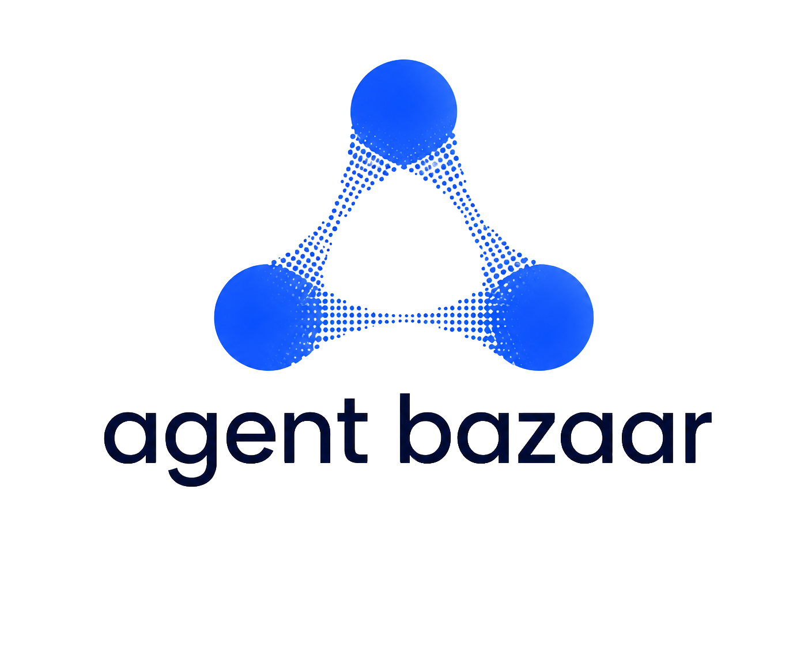

# Kiba

### Your AI assistant, now with a wallet.

Kiba lets an AI assistant find specialized services and pay for them per use, in USDC on Stellar, within the same conversation.
No accounts, API keys or subscriptions are required.

**[Get started](https://app.kiba.tools)**

[Website](https://kiba.tools) · [Documentation](https://docs.kiba.tools) · [Publish a service](packages/sdk/README.md)

---

## Overview

> **User:** I need a font for our new logo. It will be used on the website, on packaging and in ads.
>
> **Assistant:** Found *Marlow Sans* in a type foundry's catalog on Kiba: $40, commercial license covering web, print, merchandise and advertising. Paid. Here are the font files and the license document. The payment transaction carries the license fingerprint.

A font is bought, not generated, and a logo needs one with a license that covers every place it will appear. The assistant searches the catalogs, obtains a price and the terms, pays the foundry and returns the files with a license that can be verified. None of this is possible for an assistant on its own: it cannot open an account with the foundry, pay it or prove the rights it acquired.

Kiba is a payments layer for AI assistants. It consists of a connector for assistants (MCP), a gateway that discovers services and charges per call, an SDK for publishing services, and a Soroban contract that settles every payment in USDC on Stellar.

## The problem

The best results rarely come from a general-purpose model alone. They come from specialized services: a scraper that reads any site, a 3D generator, a music composer, a live data feed. Each of them requires an account, an API key and, in most cases, a subscription. An assistant cannot complete those steps on behalf of its user, so it falls back on generic answers.

| | Without Kiba | With Kiba |
|---|---|---|
| **Using a service** | Create an account, copy a key, pay a subscription | Ask the assistant |
| **Paying** | A plan per service, used or not | Per call, only for what is used |
| **Selling a service** | Build billing, accounts and a storefront first | Publish once; paid from the first call |

---

## For users

- **Works with existing assistants.** Claude, ChatGPT, Cursor and any MCP-compatible client. One-click installer on Windows; one command on other systems.
- **One balance.** Top up once; every call and its price appear in the account history.
- **A wallet controlled by the user.** The payments wallet belongs to the user, not to Kiba. One spending permission lets the assistant pay without interruptions. Funds can be added, withdrawn or the permission revoked at any time.
- **Fast.** Paid calls respond in under a second; settlement on Stellar follows within seconds.

## For publishers

- **Publish once, earn per call.** Wrap an API, model or tool with the open SDK and set a price. Every connected assistant can find and pay the service.
- **Paid in USDC.** Publishers keep 95% of every call. Payouts settle on-chain.
- **Flexible pricing.** A fixed price per call, or a price computed from each request: per page, per character, per second of audio.
- **Verified, paid traffic.** Every request arrives signed by Kiba. The service only serves paid requests, with no shared secrets.
- **Reporting.** Calls, earnings and payouts per service in the publisher dashboard.

## For developers

- **[`kiba-mcp`](https://www.npmjs.com/package/kiba-mcp)**: the connector for AI assistants, with OAuth sign-in. The assistant never handles a key.
- **[`kiba-sdk`](https://www.npmjs.com/package/kiba-sdk)**: open SDK to publish services or to call them from an application with its own wallet.
- **REST API**: the same catalog and payments for any application, with or without an assistant.
- **Discovery**: keyword and semantic search combined, so a plain-language request is routed to the right service.

---

## Services

| Service | Description |
|---|---|
| **web-scraper** | Reads any web page, including JavaScript-heavy sites. Powered by Firecrawl. |
| **3d-generator** | Produces a downloadable 3D model from a text description. Powered by Meshy. |
| **music-generator** | Composes songs and clips from a prompt. Powered by Google Lyria. |
| **media-catalog** | Licensed photos and music clips from an independent creator. Every download includes a license whose fingerprint travels in the Stellar payment. |
| **world-clock** | Current time and time zones for any city. |
| **randomizer** | Cryptographically secure random numbers, dice, draws and shuffles. |

The catalog is open. See [publishing a service](packages/sdk/README.md).

---

## How it works

1. **Discovery.** Every service is listed in an open on-chain registry. Publishing a service adds it to the catalog.
2. **Quote.** The service prices the specific request.
3. **Payment.** Charged to the user's credits or payments wallet.
4. **Settlement.** Kiba's Soroban payments contract pays the publisher in USDC and enforces the split on-chain: 95% to the publisher, 5% to Kiba.

Further reading: [architecture](docs/architecture.md).

## Security

- **Spending limits.** Pending usage on the payments wallet is capped and collected automatically.
- **No double charges.** Every collection is recorded, reconciled and verifiable.
- **Exit at any time.** The full balance can be withdrawn, or the permission revoked, in one step.
- **Auditable.** Every payout is a public transaction on [stellar.expert](https://stellar.expert/explorer/testnet).

---

## Licensed media

A photo, a music clip or a 3D model bought through an assistant comes with a **license that can be proven**.

- **The payment is the proof.** Each purchase writes a plain license document: buyer, seller, SHA-256 of the file, terms and price. The Stellar transaction that pays for the call carries the document's fingerprint in the `reference` argument of the payments contract. Anyone can download the document, hash it and compare it with the transaction. There is no certificate, token or signature to trust.
- **Clear terms.** Three templates (`personal`, `commercial`, `commercial-attribution`) with media-industry uses (advertising, social media, broadcast, print, merchandise, editorial, web), adjustable per item. AI-generated media is labelled as non-exclusive and not unique.
- **Free search across every catalog.** `search_media("lofi beat")` queries all publisher catalogs at once. Buying is one `call_agent(service, { assetId })`.
- **Catalogs in minutes.** A folder plus an `items.csv`, or an existing S3 bucket, database or feed behind a four-function interface. Kiba never connects to the publisher's data.
- **Existing catalog APIs.** `HttpCatalogSource` reads a publisher's existing API with the publisher's own key and maps its records to Kiba's format. Each purchase requests a fresh signed download link from that API. The publisher's process holds the key; Kiba never does.

Further reading: [media licenses](https://docs.kiba.tools/licencias) · [SDK: catalogs](packages/sdk/README.md#media-licenses-and-catalogs).

---

## HackMeridian 2026

**Starting point.** Before 25 October 2026, Kiba was in production: the gateway and the MCP connector, the SDK, the Soroban payments contract, the user's payments wallet, the dashboard, documentation in three languages and ten published services.

**New work during the event (25 and 26 October): licensed media.** All of it is in the [`hackmeridian-2026`](https://github.com/CoKeFish/kiba/commits/hackmeridian-2026) branch, with timestamped commits. [HACKMERIDIAN.md](HACKMERIDIAN.md) is the guide for the jury: the problem, how it works, how to verify a license, and what is simulated.

**Problem.** When an assistant buys a photo or a music clip on behalf of a user, the user receives a file and nothing else. There is no answer to the question of whether the file may be used in an advertisement. Stock sites solve this with accounts and invoices; assistants have neither.

**Target users.** People who ask an assistant for media they intend to publish, and creators who want to sell their files to every assistant without building a store.

**Delivered.**

- A license document for every purchased file: buyer, seller, file hash, terms and price. Its fingerprint travels in the Stellar payment, in the `reference` argument of the payments contract.
- A public verification page that recomputes the document's hash, reads the transaction and checks the fingerprint.
- License terms in plain language: three templates with media-industry uses, adjustable per item.
- Catalogs in the SDK: a folder plus a CSV becomes a service with free search, per-item prices and signed download links.
- `search_media` in the connector and the API: one query, every catalog.
- `HttpCatalogSource` in the SDK, and `andes-stock`, a simulated stock agency whose existing API (its own key, record format and signed links) is sold through Kiba without migrating its catalog.
- A catalog browser, a license card and a readable summary of each call in the dashboard. Documentation in Spanish, English and Portuguese.
- Demo content made by the team: photos and backgrounds generated with AI, music composed by code.
- Fixes in what ships today: the announced price is the price charged, the x402 quote is bound to the request body, an on-chain hash that arrived early is no longer lost, and the `media-catalog` description fits the registry contract's 512-byte limit.

**Architecture.** Purchase → Kiba writes the license document and computes its SHA-256 → the payment transaction carries the first 8 bytes of the hash → the file is delivered together with the document → any party verifies by hashing the document and comparing it with the transaction.

**Business model.** The same as every Kiba call: the creator keeps 95% of each sale in USDC and Kiba keeps 5%. There are no listing fees.

**Next steps.** Orders with several files under one license and a minimum amount per order. Verification on mainnet. External creators publishing their own catalogs.

---

## Team

Bogotá, Colombia.

- **Rodion Tabares**, engineering ([GitHub](https://github.com/CoKeFish))
- **André Landinez**, engineering ([GitHub](https://github.com/andreMD287))
- **Lizeth Rico**, design ([GitHub](https://github.com/ricoththth))
- **Angie Alpízar Porras**, design and front end ([GitHub](https://github.com/Ansllxs))

Built on the [Model Context Protocol](https://modelcontextprotocol.io/) and [Stellar](https://stellar.org).

## License

[MIT](LICENSE)
