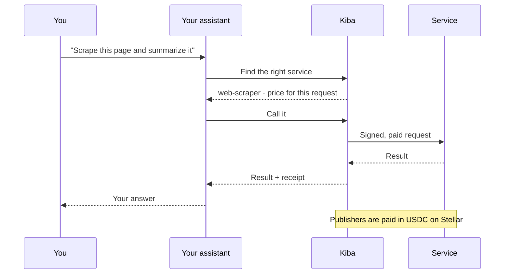

<div align="center">


# Kiba

### Your AI assistant, now with a wallet.

Kiba lets any AI assistant find specialized services and pay for them on the spot —
per use, in the same conversation. No sign-ups. No API keys. No subscriptions.

**[Get started free →](https://app.kiba.tools)**

[Website](https://kiba.tools) · [Docs](https://docs.kiba.tools) · [Publish your service](packages/sdk/README.md)

[](https://modelcontextprotocol.io/)
[](https://x402.org/)
[](https://stellar.expert/explorer/testnet/contract/CDYLMRS2UTBHNTWS67NC2OPQIH2HXGS36WZYC4JUMLKZWT7XXVUUX7XF)
[](https://www.npmjs.com/package/kiba-mcp)
[](https://www.npmjs.com/package/kiba-sdk)
[](LICENSE)

</div>

---

## Ask. Your assistant handles the rest.

> **You:** Make me a 30-second lo-fi track for my video intro.
>
> **Assistant:** Found *music-generator* on Kiba — $0.05 for this. Paid. Here's your track. 🎵

That's it. Your assistant discovers the right service, checks the price, pays, and brings back the result. You just ask.

## One connection. Every specialist.

The best answers rarely come from a general-purpose model alone. They come from specialists — a scraper that can read any site, a 3D generator, a composer, a live data feed. Until now, each one meant another account, another key, another monthly plan.

**Kiba turns all of them into one tap away.**

| | Before | With Kiba |
|---|---|---|
| **Using a service** | Create an account, copy a key, pay a subscription | Just ask your assistant |
| **Paying** | A plan per service, used or not | Pay only for what you use, per call |
| **Selling a service** | Build billing, accounts and a storefront first | Publish once, get paid from day one |

---

## Built for people who use AI

- 🧠 **Works with the assistant you already love** — Claude, ChatGPT, Cursor and every MCP-compatible client. Install in one click on Windows, or one line anywhere else.
- 💳 **One balance, endless services** — top up once and your assistant pays as it goes. Every call, with its price, in your history.
- 🔐 **A wallet that's truly yours** — your payments wallet is controlled by you, not by us. Sign one spending permission and your assistant pays without interrupting you. Top up, withdraw or revoke anytime.
- 🎁 **Free credits to start** — explore the catalog before adding a cent.
- ⚡ **Instant** — paid calls come back in a fraction of a second.

## Built for people who build

- 🚀 **Publish once, earn per call** — wrap your API, model or tool with the open SDK, set your price, and every connected assistant can find and pay you.
- 💸 **Get paid in USDC** — keep **95%** of every call. Payouts settle on-chain, transparently.
- 🧮 **Price it your way** — flat per call, or computed from each request: per page, per character, per second of audio.
- 🛡️ **Verified, paid traffic** — every call arrives signed by Kiba, so you serve only paid requests, with no shared secrets to leak.
- 📊 **Your numbers, live** — calls, earnings and payouts per service in your publisher dashboard.

## Built for developers

- **[`kiba-mcp`](https://www.npmjs.com/package/kiba-mcp)** — the connector for AI assistants, with OAuth sign-in. Your assistant never touches a key.
- **[`kiba-sdk`](https://www.npmjs.com/package/kiba-sdk)** — open SDK to publish services or call them from your own app and wallet.
- **REST API** — the same catalog and payments for any app, assistant or not.
- **Smart discovery** — keyword and semantic search combined, so a plain-language request lands on the right service.

---

## Featured services

| | Service | What it does |
|---|---|---|
| 🕸️ | **web-scraper** | Reads any web page — even JavaScript-heavy sites — powered by Firecrawl |
| 🧊 | **3d-generator** | Turns a sentence into a downloadable 3D model, powered by Meshy |
| 🎵 | **music-generator** | Composes songs and clips from a prompt, powered by Google Lyria |
| 🌍 | **world-clock** | Live time and time zones for any city on Earth |
| 🎲 | **randomizer** | Cryptographically secure random numbers, dice, draws and shuffles |

…and a growing catalog. **[Add yours →](packages/sdk/README.md)**

---

## How it works



1. **Discover** — every service lives in an open on-chain registry: publish it and it's in the catalog.
2. **Quote** — the service prices this exact request.
3. **Pay** — from your credits or your payments wallet, instantly.
4. **Settle** — publisher earnings are paid out in USDC through [Trustless Work](https://www.trustlesswork.com) escrows, with the split enforced on-chain.

Go deeper: [architecture](docs/architecture.md) · [settlement](docs/trustless-work.md)

## Safe by design

- **Spending limits built in** — pending usage on your wallet is capped and collected automatically.
- **Never charged twice** — every collection is recorded, reconciled and verifiable.
- **Leave anytime** — withdraw your full balance or revoke the permission in one click.
- **No keys in the chat** — sign-in by OAuth; your assistant never sees a secret.
- **Fully auditable** — every payout is a public transaction on [stellar.expert](https://stellar.expert/explorer/testnet).

---

## Get started

**Add Kiba to your assistant:**

```json
{
  "mcpServers": {
    "kiba": { "command": "npx", "args": ["-y", "kiba-mcp"] }
  }
}
```

The first call opens your browser to sign in — that's all. On Windows, grab the [installer](packages/installer/README.md).

**Run the platform yourself:**

```bash
git clone https://github.com/CoKeFish/kiba
cd kiba
cp .env.example .env
docker compose up --build -d
```

Landing at `localhost:3010` · dashboard at `localhost:3020` · API at `localhost:8000`.

<details>
<summary><b>Under the hood</b></summary>

| Layer | Stack |
|---|---|
| Registry | Rust smart contract on Soroban (Stellar) |
| Settlement | Trustless Work escrows in USDC, 95/5 split |
| Payments wallet | User-owned Stellar wallet (Privy or any Stellar wallet) with a spending permission |
| Gateway | Node 20, Express, Postgres, OAuth 2.0 + PKCE |
| Discovery | Keyword (BM25) + semantic embeddings, in-process |
| Apps | React 19 + Vite, Astro 5, Tailwind 4 |
| Connector / SDK | `kiba-mcp`, `kiba-sdk` |
| Installer | Tauri 2 (Windows) |

```
packages/
  gateway/            accounts, payments, payments wallet, settlement
  backend/            catalog and search
  contracts-soroban/  on-chain service registry
  sdk/                kiba-sdk — publish or call services
  mcp-server/         kiba-mcp — connector for assistants
  dashboard/          app.kiba.tools
  landing/            kiba.tools
  docs/               docs.kiba.tools
  demo-agents/        featured services
  orchestrator-agent/ multi-step planner
  installer/          Windows installer
```

</details>

---

## Team

Made in Bogotá, Colombia 🇨🇴

- **Rodion Tabares** — Engineering ([GitHub](https://github.com/CoKeFish))
- **André Landinez** — Engineering ([GitHub](https://github.com/andreMD287))
- **Lizeth Rico** — Design ([GitHub](https://github.com/ricoththth))
- **Angie Alpízar Porras** — Design & frontend ([GitHub](https://github.com/Ansllxs))

Built on the [Model Context Protocol](https://modelcontextprotocol.io/), [x402](https://x402.org/), [Stellar](https://stellar.org) and [Trustless Work](https://www.trustlesswork.com).

## License

[MIT](LICENSE)
