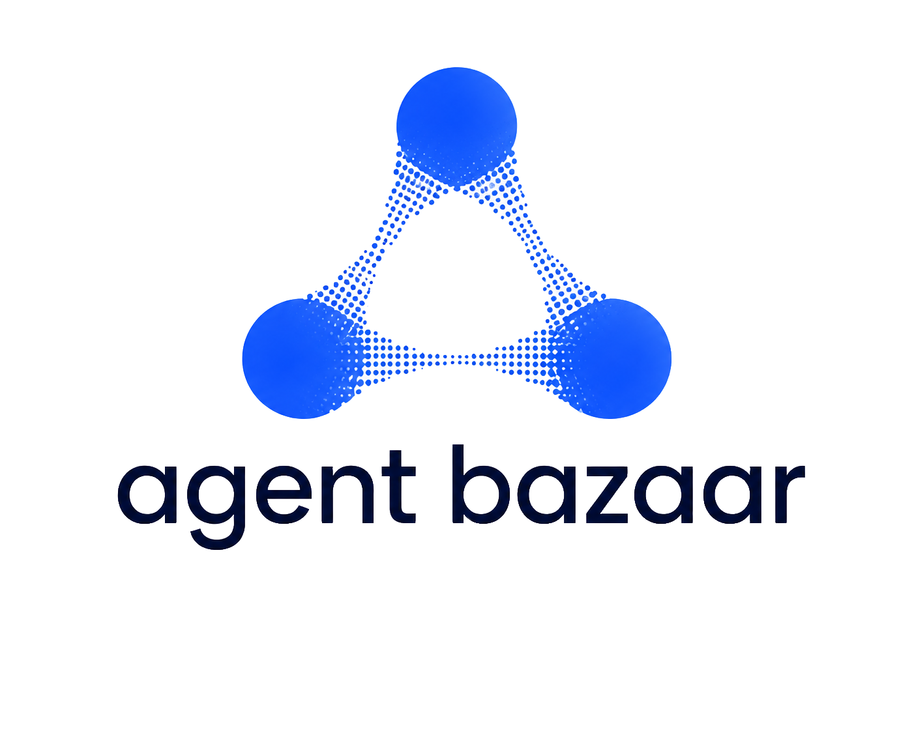
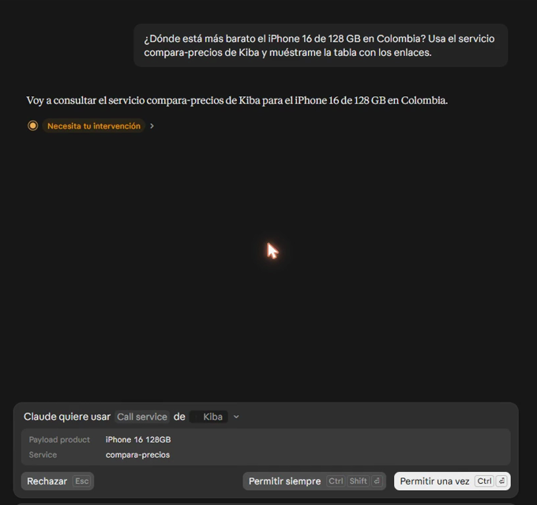
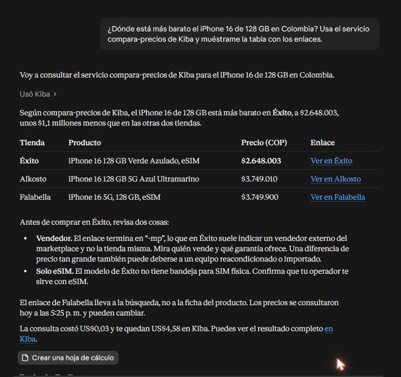
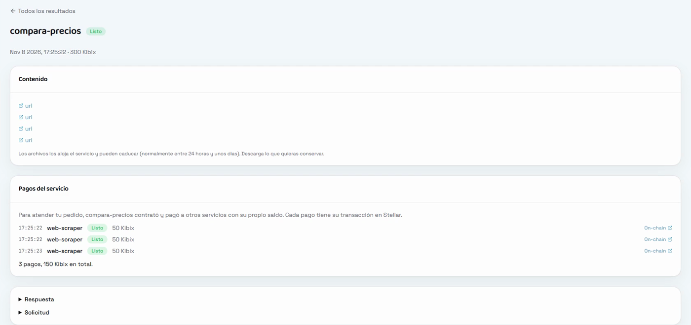

<div align="center">



# Kiba

### Your AI assistant, now with a wallet.

Kiba lets an AI assistant find specialized services and pay for them per use, in USDC on Stellar, within the same conversation.
No accounts, API keys or subscriptions are required.

**[Get started](https://app.kiba.tools)**

[Website](https://kiba.tools) · [Documentation](https://docs.kiba.tools) · [Publish a service](packages/sdk/README.md)

[](https://modelcontextprotocol.io/)
[](https://x402.org/)
[](https://stellar.expert/explorer/testnet/contract/CBARSI2VGH7SDUA2WD3CUEGWFY6GYGC2WRW5JYGYMR4BR2Q3WZHKDWL7)
[](https://www.npmjs.com/package/kiba-mcp)
[](https://www.npmjs.com/package/kiba-sdk)
[](LICENSE)

</div>

---

## Código Cordillera 2026 · track Scale

> Sección para el jurado, en español. El resto del documento describe el producto en inglés. Proyecto en [Stellar Apex](https://stellarapex.org/projects/3bce6a11-3bee-4825-bc07-a44828d45f63); el video pitch está en su campo "demo url".

**En cinco líneas.** Los asistentes de IA no pueden pagar: cada servicio especializado exige cuenta, clave y suscripción, y el asistente se queda en respuestas genéricas. Kiba es el marketplace donde el asistente encuentra un servicio y lo paga por uso, en USDC sobre Stellar, dentro de la conversación. Llegamos al kickoff con el producto en testnet: gateway, conector MCP, SDK, contrato de pagos en Soroban, dashboard y catálogo. En las 48 horas del evento construimos **x402 estándar en ambos sentidos** y **servicios que pagan servicios**: un servicio de Kiba ahora contrata a otros y les paga desde su código, y el usuario ve toda la cascada con sus transacciones en Stellar. Lo siguiente es mainnet.

### En qué se diferencia Kiba de lo que ya hay

Stellar ya tiene piezas para que los agentes paguen, y Kiba es compatible con cualquier API o cliente x402 estándar en Stellar. La diferencia está en para quién es y en qué resuelve.

| Lo que ya existe en el ecosistema | Qué resuelve | Kiba |
|---|---|---|
| Infraestructura de pagos x402 en operación, financiada por SCF: [Rail402](https://stellarlight.xyz/project/rail402) (facilitador y herramientas x402), [ApiCharge](https://stellarlight.xyz/project/apicharge) (cobro por uso de APIs) | El desarrollador que tiene una API y quiere cobrarla a agentes | Kiba usa esa capa, no compite con ella: sus servicios aceptan x402 y su conector paga x402. Lo que añade es el marketplace: catálogo con búsqueda en lenguaje natural, precio por pedido, panel de ganancias y liquidación 95/5, y clientes que no necesitan wallet. |
| Cobrar por un servidor MCP o una API con una línea de código, prototipos de hackathon: [TollPay](https://dorahacks.io/buidl/42585), [x402-mcp-stellar-template](https://dorahacks.io/buidl/42579) | Lo mismo, del lado del servidor | El publicador de Kiba cobra igual de fácil con el SDK, pero además lo encuentran y lo pagan usuarios sin cripto. |
| Darle una wallet al agente o enrutar sus pagos, prototipos: [x402 Stellar MCP](https://dorahacks.io/buidl/42803), [Starlane](https://dorahacks.io/buidl/42825) | El desarrollador que construye su propio agente y quiere que pague | Kiba es para la persona que ya usa Claude, ChatGPT o Cursor: crea una cuenta con su correo, recarga en pesos o en USDC y su asistente paga. Nada que programar ni instalar en el agente. |
| Marketplaces y pagos entre agentes, prototipos: [StellarPayAgent](https://dorahacks.io/buidl/42087), [Stellar Agent Gateway](https://dorahacks.io/buidl/42534), [HivePayAI](https://dorahacks.io/buidl/42438), [Stellar Agentic](https://dorahacks.io/buidl/42358) | Agentes que descubren y pagan APIs o se contratan entre sí | Kiba opera en testnet desde julio de 2026 con 15 servicios, historial verificable de pedidos y liquidaciones, instalador, paquetes en npm y documentación en tres idiomas. Cuando un servicio de Kiba contrata a otro, la cascada queda ligada al pedido del usuario y visible con sus transacciones. |

Y dos cosas que, hasta donde sabemos, no hace nadie más en el ecosistema: **licencias de uso ancladas al pago** para medios comprados por un asistente, y **un solo saldo** que sirve tanto en el riel propio de Kiba como en x402 estándar.

### Qué existe hoy que no existía al kickoff

Punto de partida: tag [`kickoff`](https://github.com/CoKeFish/kiba/releases/tag/kickoff) = commit [`70fe1d2`](https://github.com/CoKeFish/kiba/commit/70fe1d2), el último antes del evento (26 de octubre). El kickoff fue el 6 de noviembre a las 10:20 (Bogotá). Todo lo de abajo está en `main`, y [GitHub Actions](https://github.com/CoKeFish/kiba/actions/workflows/deploy.yml) lo despliega en el entorno público de testnet en cada push a `main` que toca el stack ([última ejecución](https://github.com/CoKeFish/kiba/actions/runs/42529718591), 8 de noviembre, 17:20 Bogotá).

**[Comparar kickoff → main](https://github.com/CoKeFish/kiba/compare/kickoff...main): 34 commits entre el 7 y el 8 de noviembre (12 de funciones, 10 de arreglos, 2 de pruebas, 5 de documentación, 4 de CI y versiones, 1 merge; 80 archivos, +6.058 / −134 líneas), más la documentación de esta entrega.**

| | Al kickoff (6 nov) | Hoy (8 nov) |
|---|---|---|
| **Pagar APIs fuera de Kiba** | Solo servicios del catálogo de Kiba | `call_url`: el asistente paga **cualquier API x402 estándar en Stellar** con su saldo de Kiba. Tope por llamada, reembolso si la API rechaza la llamada antes de cobrar, transacción en la cuenta. |
| **Cobrar a clientes fuera de Kiba** | Handshake 402 propio de Kiba | Cada servicio del SDK acepta **x402 estándar** (`PAYMENT-REQUIRED` con precio dinámico, `PAYMENT-SIGNATURE`, `PAYMENT-RESPONSE` con el hash), con facilitador o liquidando por sí mismo. Una variable de entorno lo activa. |
| **Servicios que pagan servicios** | No existía | El handler recibe `ctx.kiba` para contratar y pagar a otros servicios y APIs x402 con el saldo del publicador. El gateway liga esos pagos al pedido del usuario y los devuelve como `subCalls` en el conector, la API y el dashboard. |
| **Servicios nuevos** | 13 servicios | 15: **web-brief** (paga a web-scraper y translator-pro) y **compara-precios** (paga a web-scraper por cada tienda colombiana y dice dónde está más barato). |
| **Resultados** | Enlaces que caducaban | El almacén de resultados guarda los archivos que generan los servicios (modelos 3D, canciones, licencias) y los sirve desde `api.kiba.tools`; el dashboard los previsualiza y descarga. |
| **Arreglos (no cuentan como funciones)** | | translator-pro traduce con Gemini; web-scraper no inventa datos, lee YouTube y da errores claros; el conector muestra la causa real de un fallo. [`kiba-mcp` 0.1.9](https://www.npmjs.com/package/kiba-mcp/v/0.1.9) publicado el 8 de noviembre con `call_url`. |

Commits por función: x402 comprador `123be1f` `8c79d6a`; x402 vendedor `828f1fa` `d01f8f0`; servicios que pagan servicios `2a53e5a` `b647705` `3f5fe3f` `2c221e0`; archivos en los resultados `a3fe6c1` `ea4f0d6`; compara-precios `cb67bb1`; traductor real `507010c`. El trabajo de x402 se hizo el 7 de noviembre (lo fechan sus transacciones de prueba en testnet, enlazadas abajo) y se publicó en `main` el 8 a las 12:24 en una sola tanda, por eso varios commits comparten la hora. Los contratos de Soroban no cambiaron durante el evento. El estado final de la entrega lleva el tag `cordillera-final`. Pruebas automáticas nuevas: `packages/gateway/test/x402.test.ts`, `cascade.test.ts`, `files.test.ts`, `packages/sdk/test/x402-standard.test.ts`, `gateway-client.test.ts`, `call-context.test.ts`. Ejemplos ejecutables: [`examples/x402-seller`](examples/x402-seller) y [`examples/x402-buyer`](examples/x402-buyer).

### La demo, con sus transacciones

Un usuario le pide a Claude dónde está más barato el iPhone 16 en Colombia usando `compara-precios` de Kiba. Claude pide permiso antes de llamarlo; la llamada cuesta 0,03 USDC, que aparecen en la respuesta y en la cuenta. El servicio contrata a `web-scraper` tres veces, una por tienda, y le paga con su propio saldo. El usuario recibe la tabla y en su cuenta ve el pedido con los tres pagos del servicio, cada uno con su transacción en Stellar.

<p align="center">


</p>

<p align="center">

</p>

| Pago | Transacción en Stellar (testnet) |
|---|---|
| Usuario → compara-precios, 0,03 USDC | [`6b89ad33…`](https://stellar.expert/explorer/testnet/tx/6b89ad33ecccfa7626db5bfd902fa9f3c23ec39e20177960623b83a87cb80374) |
| compara-precios → web-scraper (Éxito), 0,005 USDC | [`7e67efb8…`](https://stellar.expert/explorer/testnet/tx/7e67efb84df0f671fb900c3787a8aadd67486f8a93da0f638df4034e66c00e9e) |
| compara-precios → web-scraper (Falabella), 0,005 USDC | [`504c7f85…`](https://stellar.expert/explorer/testnet/tx/504c7f85cdddbdc6da0f11fee5c027de8c348279fddd46d74ed0c9a56d702674) |
| compara-precios → web-scraper (Alkosto), 0,005 USDC | [`21da6d59…`](https://stellar.expert/explorer/testnet/tx/21da6d595fcb8366cf1abb36e5f3951c9c163a3dd250efb7a330b0fffdfe6dfb) |
| Usuario → web-brief, 0,02 USDC; web-brief → web-scraper y translator-pro | [`d6d104d7…`](https://stellar.expert/explorer/testnet/tx/d6d104d72b7f910e7d64d1931db87a208301dfbb5239a1ae1dbc4b0b9377b852) · [`7f549278…`](https://stellar.expert/explorer/testnet/tx/7f5492786e42940d082678139e4b725eaf8804e9b18e90272e759f26eb40e84d) · [`3040218a…`](https://stellar.expert/explorer/testnet/tx/3040218abdcaeb2b1536981885e4168a8712ff3e34db1974c913bec6378dcb1e) |
| x402 estándar, pruebas del 7 de noviembre en testnet: Kiba paga la API ajena de `examples/x402-seller` · el cliente genérico de `examples/x402-buyer` paga un servicio de Kiba por el facilitador de x402.org y por liquidación propia | [`d6dab3eb…`](https://stellar.expert/explorer/testnet/tx/d6dab3ebd3c708562255c7df93737c847b5a48a4a661705089d54ceb4da54398) · [`2cc3d750…`](https://stellar.expert/explorer/testnet/tx/2cc3d750b2c9e4826f98c72ca05a24e6c99e3c005ba6b0f92f38d834dec0ec2a) · [`a0e23d16…`](https://stellar.expert/explorer/testnet/tx/a0e23d1612afca58d0a217c14e59c5d79b07a19df858158ed6e1df3843972f9d) |

Los pagos por el riel de Kiba (usuario → servicio y servicio → servicio) son invocaciones a `pay()` del [contrato de pagos](https://stellar.expert/explorer/testnet/contract/CBARSI2VGH7SDUA2WD3CUEGWFY6GYGC2WRW5JYGYMR4BR2Q3WZHKDWL7) de Kiba en Soroban, que entrega el 95 % al publicador y el 5 % a Kiba en la misma transacción (la comisión se fija al desplegar el contrato; en la transacción del usuario de arriba: 285.000 y 15.000 de 300.000). Los pagos x402 estándar de la última fila se liquidan como transferencias de USDC a través del facilitador, como manda el estándar.

Cualquiera puede comprobar que los servicios hablan x402 en producción: una llamada sin pago devuelve el 402 estándar con la cabecera `Payment-Required` (versión 2 del protocolo, USDC en Stellar, 0,02 USDC para web-brief).

```bash
curl -si -X POST https://agent-web.kiba.tools/service -H 'content-type: application/json' -d '{"url":"https://stellar.org","lang":"es"}' | grep -iE '^HTTP|^Payment-Required'
# HTTP/1.1 402 Payment Required
# Payment-Required: eyJ4NDAyVmVyc2lvbiI6MiwiZXJyb3IiOiJQYXltZW50IHJlcXVpcmVkIiwicmVzb3VyY2UiOnsidXJsIjoiaHR0cHM6Ly9hZ2VudC13ZWIua2liYS50b29scyIs...
```

### Pruébalo tú mismo (gratis, testnet)

1. Entra en [app.kiba.tools](https://app.kiba.tools), crea tu cuenta con tu correo y recarga saldo de prueba en Facturación (Bre-B en modo de prueba, sin dinero real).
2. En Playground elige `compara-precios` y escribe un producto, o `web-brief` con una URL. Verás la respuesta y, en Resultados, los pagos que el servicio hizo a otros, cada uno con su transacción.
3. Con tu asistente: en Claude agrega el conector `https://api.kiba.tools/mcp` en Ajustes › Conectores, o instala [`kiba-mcp`](https://www.npmjs.com/package/kiba-mcp) en cualquier cliente MCP ([guía](https://docs.kiba.tools/conecta-tu-asistente/claude)), y pregunta: *"¿Dónde está más barato el iPhone 16 de 128 GB en Colombia? Usa el servicio compara-precios de Kiba"*.

### Experiencia de producto

- **Nada de wallets que instalar.** El usuario crea su cuenta con su correo, recarga y pide. No instala una wallet, no guarda semillas ni compra XLM: Kiba abre su cuenta en Stellar y paga las comisiones de red de sus transacciones. El saldo se muestra en dólares; los precios por llamada, en Kibix (1 Kibix = 0,0001 USD), y cada pago trae su enlace on-chain para quien quiera verificarlo.
- **Un permiso, cero interrupciones.** El usuario autoriza una vez un permiso de gasto sobre su wallet de pagos y el asistente paga sin pedir firma por llamada. El permiso lo impone el contrato de USDC en Stellar, con tope y vencimiento, y el usuario recarga, retira o revoca cuando quiera.
- **Un solo saldo.** Todas las llamadas y sus precios aparecen en la cuenta, con el enlace a la transacción.
- **Recargas.** En pesos por Bre-B (modo de prueba en testnet) o enviando USDC desde cualquier wallet de Stellar. Wompi (PSE, Nequi, tarjeta) está programado en el gateway y el dashboard y se activa con las llaves del comercio al salir a mainnet.
- **Funciona en los asistentes que ya usas:** Claude, ChatGPT, Cursor y cualquier cliente MCP ([guías de conexión](https://docs.kiba.tools/conecta-tu-asistente)); instalador de un clic en Windows.
- **Funciona en móvil.** El flujo completo ocurre en la app de Claude o de ChatGPT del teléfono, con el conector de Kiba; el panel web también abre en el navegador del móvil.

### Tracción (con fuente)

Kiba está en testnet y todavía no tiene usuarios ni publicadores externos: estas cifras son uso de prueba del equipo y de quienes lo han conectado, y las damos como señal temprana, no como ingresos. Los datos están en el repositorio, con el hash de cada pago, para que cualquiera los compruebe.

| Métrica | Valor | Fuente |
|---|---|---|
| Pagos liquidados por llamada en el contrato de pagos de Soroban (desde el 19 de octubre) | 102 invocaciones | Contador público del contrato en [stellar.expert](https://stellar.expert/explorer/testnet/contract/CBARSI2VGH7SDUA2WD3CUEGWFY6GYGC2WRW5JYGYMR4BR2Q3WZHKDWL7) |
| Pedidos a través del gateway (desde el 16 de octubre, cuando nació el almacén de resultados) | 277 de 5 cuentas: 266 completados y 11 con error. 180 de ellos son una prueba de carga de `world-clock` el 19 de octubre; sin esa prueba quedan 97 pedidos reales (86 completados). Durante el evento: 83 pedidos (73 completados), 33 de ellos pagos entre servicios | [`docs/metrics/pedidos-2026-11-08.csv`](docs/metrics/pedidos-2026-11-08.csv): fecha, cuenta anonimizada, servicio, estado, costo y, en los 105 pedidos liquidados por llamada, el enlace a su transacción |
| Liquidaciones a publicadores (desde julio de 2026) | 97 liquidadas y 1 fallida | [`docs/metrics/liquidaciones-2026-11-08.csv`](docs/metrics/liquidaciones-2026-11-08.csv): fecha, servicio, monto y referencia on-chain (hash de la transacción o, en la primera, el escrow que la liquidó) |
| Entrevistas con desarrolladores que construyen con agentes | 3 entrevistas grabadas en video, de 12 a 15 minutos, en octubre de 2026: confirman que encontrar la herramienta adecuada cuesta tiempo, que pagan por uso si el precio tiene sentido y que publicar un servicio propio atrae | [`docs/entrevistas.md`](docs/entrevistas.md): perfiles, citas, conclusiones y el video completo de cada entrevista |
| Servicios publicados en el catálogo | 15, publicados por el equipo como demostración | [Catálogo](https://app.kiba.tools) |
| Participaciones | Stellar PULSO 2026 ([DoraHacks](https://dorahacks.io/buidl/46218)) y Código Cordillera 2026; las licencias de medios se construyeron durante HackMeridian 2026 ([rama](https://github.com/CoKeFish/kiba/commits/hackmeridian-2026)) | DoraHacks, GitHub, Stellar Apex |

Las tres primeras filas se solapan: desde el 19 de octubre cada pago por llamada pasa por el contrato, queda en el pedido y genera su liquidación, así que no son volúmenes que se sumen. Las diferencias son los pagos anteriores al contrato (julio y 16 a 17 de octubre) y las liquidaciones por lotes.

Distribución, que no es uso: 680 descargas de `kiba-mcp` en [npm](https://www.npmjs.com/package/kiba-mcp) en los últimos 30 días y 51 del [instalador de Windows 0.1.6](https://github.com/CoKeFish/kiba/releases). Todavía no hay publicadores externos ni pagos en mainnet: ese es el siguiente hito.

### Stellar: esencial, y la ruta a mainnet

Stellar no es un detalle de Kiba: es el riel. Cada llamada pagada termina en `pay()` del contrato de pagos en Soroban, en USDC, con el reparto 95/5 fijado en el contrato y visible en cada transacción; el registro de servicios es un contrato; la wallet de pagos del usuario es una cuenta Stellar con un permiso `approve` sobre el contrato de USDC (SEP-41) y comisiones pagadas por Kiba con fee-bump; y la interoperabilidad es x402 sobre Stellar con los paquetes oficiales `@x402/stellar`. Sin Stellar no hay producto.

Lo que ya existe para mainnet: el SDK trae la configuración `mainnet` con el USDC de Circle (`packages/sdk/src/config.ts`, aún sin ejercitar en esa red), el contrato de pagos tiene su batería de pruebas (`packages/contracts-payments/src/test.rs`) y la documentación ya describe [qué cambia para un publicador en mainnet](https://docs.kiba.tools/publica-un-servicio/mainnet). Lo que falta son los pasos de la tabla.

| Hito | Fecha | Qué cambia |
|---|---|---|
| Contratos de pagos y registro desplegados en mainnet; facilitador [OpenZeppelin](https://channels.openzeppelin.com/x402) con USDC de Circle; revisión de seguridad de la autenticación y cifrado en reposo; primer pago real | Diciembre de 2026 | Los publicadores cobran dinero real |
| Recargas con cualquier activo de Stellar (path payments: el usuario paga en XLM o EURC, Kiba recibe USDC) y recarga en pesos con Wompi | Enero de 2027 | Recargar sin saber qué es USDC |
| MPP Session como forma estándar del canal de vales (un depósito, muchos compromisos off-chain, una liquidación); listado en x402 discovery | Febrero de 2027 | Cualquier agente x402 encuentra y paga servicios de Kiba |

### Financiamiento y lanzamiento

- **Instaward de BAF (Colombia):** propuesta para el ciclo de noviembre de 2026, en preparación con el chapter según las [reglas de Instawards](https://stellar.gitbook.io/scf-handbook/scf-awards/instawards/official-rules): reputación on-chain de servicios, instaladores macOS y Linux, interfaz.
- **SCF Build:** postulación en la ronda siguiente a la 46 (noviembre de 2026), en el primer trimestre de 2027, con mainnet ya desplegada. [communityfund.stellar.org](https://communityfund.stellar.org/)
- **Primeros publicadores externos:** creadores y dueños de APIs que cobren por Kiba en mainnet durante el primer trimestre de 2027.

### Equipo

Bogotá, Colombia. [Rodion Tabares](https://github.com/CoKeFish), ingeniería. [André Landinez](https://github.com/andreMD287), ingeniería y documentación. [Lizeth Rico](https://github.com/ricoththth), diseño. [Angie Alpízar Porras](https://github.com/Ansllxs), diseño y front end. Los 34 commits del evento son de Rodion (autor git `Romanovich`).

---

<details>
<summary><b>Product documentation (English)</b></summary>

## Overview

> **User:** I need a font for our new logo. It will be used on the website, on packaging and in ads.
>
> **Assistant:** Found *Marlow Sans* in Tipos del Sur's catalog on Kiba: $40, commercial license covering web, print, merchandise and advertising. Paid. Here are the font files and the license document. The payment transaction carries the license fingerprint.

A font is bought, not generated, and a logo needs one with a license that covers every place it will appear. The assistant searches the catalogs, obtains a price and the terms, pays the foundry and returns the files with a license that can be verified. None of this is possible for an assistant on its own: it cannot open an account with the foundry, pay it or prove the rights it acquired. (Tipos del Sur is a demo foundry published by the team to exercise the flow.)

Kiba is a payments layer for AI assistants. It consists of a connector for assistants (MCP), a gateway that discovers services and charges per call, an SDK for publishing services, and a Soroban contract that settles every payment in USDC on Stellar.

## The problem

The best results rarely come from a general-purpose model alone. They come from specialized services: a scraper that reads any site, a 3D generator, a music composer, a live data feed. Each of them requires an account, an API key and, in most cases, a subscription. An assistant cannot complete those steps on behalf of its user, so it falls back on generic answers.

| | Without Kiba | With Kiba |
|---|---|---|
| **Using a service** | Create an account, copy a key, pay a subscription | Ask the assistant |
| **Paying** | A plan per service, used or not | Per call, only for what is used |
| **Selling a service** | Build billing, accounts and a storefront first | Publish once; paid from the first call |

---

## For users

- **Nothing crypto to learn.** Sign up with an email, top up, ask. No addresses, seed phrases or network fees: Kiba opens the user's Stellar account and pays the fees of their transactions.
- **Works with existing assistants.** Claude, ChatGPT, Cursor and any MCP-compatible client. One-click installer on Windows; one command on other systems.
- **One balance.** Top up once; every call and its price appear in the account history, each with its transaction.
- **One permission, no interruptions.** The user authorizes a spending permission on a dedicated payments wallet once; the assistant then pays without a signature per call. The USDC contract on Stellar enforces the permission: Kiba cannot move more than authorized or after it expires, and the user can top up, withdraw or revoke at any time.
- **Fast.** Paid calls are credited off-chain in well under a second; settlement on Stellar follows within seconds.

## For publishers

- **Publish once, earn per call.** Wrap an API, model or tool with the open SDK and set a price. Every connected assistant can find and pay the service.
- **Paid in USDC.** Publishers keep 95% of every call. Payouts settle on-chain.
- **Flexible pricing.** A fixed price per call, or a price computed from each request: per page, per character, per second of audio.
- **Verified, paid traffic.** Every request arrives signed by Kiba. The service only serves paid requests, with no shared secrets.
- **Reporting.** Calls, earnings and payouts per service in the publisher dashboard.

## For developers

- **[`kiba-mcp`](https://www.npmjs.com/package/kiba-mcp)**: the connector for AI assistants, with OAuth sign-in. The assistant never handles a key.
- **[`kiba-sdk`](https://www.npmjs.com/package/kiba-sdk)**: open SDK to publish services or to call them from an application with its own wallet.
- **REST API**: the same catalog and payments for any application, with or without an assistant.
- **Discovery**: keyword and semantic search combined, so a plain-language request is routed to the right service.

---

## Services

Fifteen services, published by the team to exercise every kind of pricing and payment. The catalog is open: see [publishing a service](packages/sdk/README.md).

| Service | Description |
|---|---|
| **web-scraper** | Reads any web page, including JavaScript-heavy sites, or extracts structured data from it. Powered by Firecrawl. |
| **compara-precios** | Finds where a product is cheapest across Colombian stores. Pays web-scraper once per store. |
| **web-brief** | Turns a URL into a brief in the user's language. Pays web-scraper and translator-pro. |
| **translator-pro** | Translation across seven languages, priced per character. |
| **3d-generator** | Downloadable 3D model from a text description or an image. Powered by Meshy. |
| **music-generator** | Songs and clips from a prompt. Powered by Google Lyria. |
| **media-catalog**, **andes-stock**, **tipos-del-sur** | Licensed photos, music clips and fonts from demo catalogs. Every download includes a license whose fingerprint travels in the Stellar payment. |
| **price-oracle**, **yield-hunter**, **risk-auditor**, **code-reviewer** | Market data and analysis, priced per symbol, protocol or line of code. |
| **world-clock**, **randomizer** | Time zones and meeting slots; cryptographically secure random numbers and draws. |

---

## How it works

1. **Discovery.** Every service is listed in an open on-chain registry. Publishing a service adds it to the catalog.
2. **Quote.** The service prices the specific request.
3. **Payment.** Charged to the user's credits or payments wallet.
4. **Settlement.** Kiba's Soroban payments contract pays the publisher in USDC and enforces the split on-chain: 95% to the publisher, 5% to Kiba.

Further reading: [architecture](https://docs.kiba.tools/conceptos/arquitectura) · [payments and settlement](https://docs.kiba.tools/conceptos/pagos-y-liquidacion).

## Contracts

Both contracts run on **Stellar testnet** and are open source in this repository. Mainnet deployment is scheduled for December 2026 (see the roadmap above).

| Contract | Role | Source | Address |
|---|---|---|---|
| **Payments** | `pay()` per call with the 95/5 split, x402 escrow and the voucher channel; the `reference` argument carries the license fingerprint | [`packages/contracts-payments`](packages/contracts-payments) | [`CBARSI2VGH7SDUA2WD3CUEGWFY6GYGC2WRW5JYGYMR4BR2Q3WZHKDWL7`](https://stellar.expert/explorer/testnet/contract/CBARSI2VGH7SDUA2WD3CUEGWFY6GYGC2WRW5JYGYMR4BR2Q3WZHKDWL7) |
| **Registry** | Open on-chain catalog of services: name, endpoint, owner and price | [`packages/contracts-soroban`](packages/contracts-soroban) | [`CDYLMRS2UTBHNTWS67NC2OPQIH2HXGS36WZYC4JUMLKZWT7XXVUUX7XF`](https://stellar.expert/explorer/testnet/contract/CDYLMRS2UTBHNTWS67NC2OPQIH2HXGS36WZYC4JUMLKZWT7XXVUUX7XF) |

Every payout is a public transaction on [stellar.expert](https://stellar.expert/explorer/testnet); pending usage on the payments wallet is capped and every collection is recorded and reconciled. See [security](https://docs.kiba.tools/recursos/seguridad).

---

## Services that pay services

A Kiba service can hire other services to do its job and pay them from its own code, with its publisher's balance. The user asks for one thing and pays once; Kiba links every payment the service makes to that request and shows the whole cascade, each payment with its transaction on Stellar.

- **In the handler.** The SDK hands every call a context: `ctx.kiba.call(service, payload)` pays any service in the catalog, `ctx.kiba.callUrl(url)` pays any API that charges with standard x402. Both use the publisher's account.
- **Linked to the request.** The gateway tells the service which call it is serving; what the service pays while serving it comes back to the user as `subCalls` in the connector, the API and the dashboard: service, cost, transaction. Never the bodies, which belong to the service's account.
- **Priced like any service.** The composite service sets its own price (flat or dynamic) and keeps the difference.

Further reading: [services that pay services](https://docs.kiba.tools/publica-un-servicio/servicios-que-pagan-servicios) · [SDK: paying other services](packages/sdk/README.md#paying-other-services-from-your-handler).

## Standard x402

Kiba speaks the open [x402](https://www.x402.org) standard on Stellar in both directions, built on the official `@x402/stellar` packages.

- **Pay any x402 API from the chat.** `call_url(url)` in the connector. Kiba reads the 402, picks the USDC-on-Stellar option, charges the user's balance and signs the payment with its treasury. The seller's facilitator settles on-chain and the answer comes back with the transaction hash. Prices above 1 USD need an explicit `maxUsd`.
- **Every Kiba service accepts x402.** With `x402` switched on in the SDK, a service answers its 402 with the standard `PAYMENT-REQUIRED` header priced for that exact request, and settles `PAYMENT-SIGNATURE` payments through a facilitator or by itself. Any x402 client pays it without Kiba's connector.
- **Kiba's own rail is unchanged.** Credits, signed calls, batched settlement and licenses keep working as before; x402 is the interoperability lane.

Examples: [`examples/x402-seller`](examples/x402-seller) and [`examples/x402-buyer`](examples/x402-buyer). Further reading: [x402 in the docs](https://docs.kiba.tools/stellar/x402) · [SDK: standard x402](packages/sdk/README.md#standard-x402-any-x402-client-can-pay-you).

## Licensed media

A photo, a music clip, a font or a 3D model bought through an assistant comes with a **license that can be proven**. Each purchase writes a plain license document (buyer, seller, SHA-256 of the file, terms, price) and the Stellar transaction that pays for the call carries the document's fingerprint in the `reference` argument of the payments contract. Anyone can download the document, hash it and compare it with the transaction. `search_media` queries every catalog at once; a catalog is a folder plus a CSV, or an existing API behind a four-function interface. Built during HackMeridian 2026 (25 and 26 October).

Further reading: [media licenses](https://docs.kiba.tools/licencias) · [SDK: catalogs](packages/sdk/README.md#media-licenses-and-catalogs).

Built on the [Model Context Protocol](https://modelcontextprotocol.io/) and [Stellar](https://stellar.org).

</details>

## License

[MIT](LICENSE)
