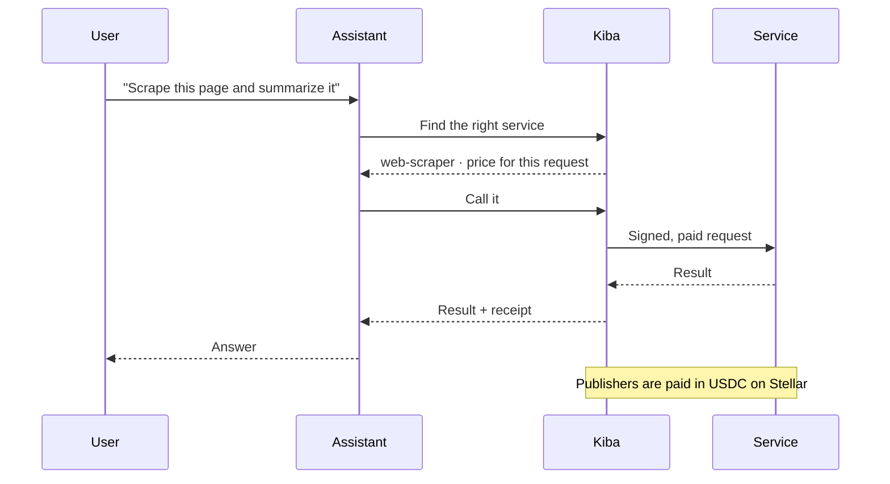

# Kiba

### Your AI assistant, now with a wallet.

Kiba lets an AI assistant find specialized services and pay for them per use, in USDC on Stellar, within the same conversation.
No accounts, API keys or subscriptions are required.

**[Get started](https://app.kiba.tools)**

[Website](https://kiba.tools) · [Documentation](https://docs.kiba.tools) · [Publish a service](packages/sdk/README.md)

---

## Overview

> **User:** I need a font for our new logo. It will be used on the website, on packaging and in ads.
>
> **Assistant:** Found *Marlow Sans* in a type foundry's catalog on Kiba: $40, commercial license covering web, print, merchandise and advertising. Paid. Here are the font files and the license document. The payment transaction carries the license fingerprint.

A font is bought, not generated, and a logo needs one with a license that covers every place it will appear. The assistant searches the catalogs, obtains a price and the terms, pays the foundry and returns the files with a license that can be verified. None of this is possible for an assistant on its own: it cannot open an account with the foundry, pay it or prove the rights it acquired.

Kiba is a payments layer for AI assistants. It consists of a connector for assistants (MCP), a gateway that discovers services and charges per call, an SDK for publishing services, and a Soroban contract that settles every payment in USDC on Stellar.

## The problem

The best results rarely come from a general-purpose model alone. They come from specialized services: a scraper that reads any site, a 3D generator, a music composer, a live data feed. Each of them requires an account, an API key and, in most cases, a subscription. An assistant cannot complete those steps on behalf of its user, so it falls back on generic answers.

| | Without Kiba | With Kiba |
|---|---|---|
| **Using a service** | Create an account, copy a key, pay a subscription | Ask the assistant |
| **Paying** | A plan per service, used or not | Per call, only for what is used |
| **Selling a service** | Build billing, accounts and a storefront first | Publish once; paid from the first call |

---

## For users

- **Works with existing assistants.** Claude, ChatGPT, Cursor and any MCP-compatible client. One-click installer on Windows; one command on other systems.
- **One balance.** Top up once; every call and its price appear in the account history.
- **A wallet controlled by the user.** The payments wallet belongs to the user, not to Kiba. One spending permission lets the assistant pay without interruptions. Funds can be added, withdrawn or the permission revoked at any time.
- **Fast.** Paid calls respond in under a second; settlement on Stellar follows within seconds.

## For publishers

- **Publish once, earn per call.** Wrap an API, model or tool with the open SDK and set a price. Every connected assistant can find and pay the service.
- **Paid in USDC.** Publishers keep 95% of every call. Payouts settle on-chain.
- **Flexible pricing.** A fixed price per call, or a price computed from each request: per page, per character, per second of audio.
- **Verified, paid traffic.** Every request arrives signed by Kiba. The service only serves paid requests, with no shared secrets.
- **Reporting.** Calls, earnings and payouts per service in the publisher dashboard.

## For developers

- **[`kiba-mcp`](https://www.npmjs.com/package/kiba-mcp)**: the connector for AI assistants, with OAuth sign-in. The assistant never handles a key.
- **[`kiba-sdk`](https://www.npmjs.com/package/kiba-sdk)**: open SDK to publish services or to call them from an application with its own wallet.
- **REST API**: the same catalog and payments for any application, with or without an assistant.
- **Discovery**: keyword and semantic search combined, so a plain-language request is routed to the right service.

---

## Services

| Service | Description |
|---|---|
| **web-scraper** | Reads any web page, including JavaScript-heavy sites. Powered by Firecrawl. |
| **3d-generator** | Produces a downloadable 3D model from a text description. Powered by Meshy. |
| **music-generator** | Composes songs and clips from a prompt. Powered by Google Lyria. |
| **media-catalog** | Licensed photos and music clips from an independent creator. Every download includes a license whose fingerprint travels in the Stellar payment. |
| **world-clock** | Current time and time zones for any city. |
| **randomizer** | Cryptographically secure random numbers, dice, draws and shuffles. |

The catalog is open. See [publishing a service](packages/sdk/README.md).

---

## How it works

1. **Discovery.** Every service is listed in an open on-chain registry. Publishing a service adds it to the catalog.
2. **Quote.** The service prices the specific request.
3. **Payment.** Charged to the user's credits or payments wallet.
4. **Settlement.** Kiba's Soroban payments contract pays the publisher in USDC and enforces the split on-chain: 95% to the publisher, 5% to Kiba.

Further reading: [architecture](docs/architecture.md).

## Contracts

Both contracts run on **Stellar testnet** and are open source in this repository.

| Contract | Role | Source | Address |
|---|---|---|---|
| **Payments** | `pay()` per call with the 95/5 split, x402 escrow and the voucher channel; the `reference` argument carries the license fingerprint | [`packages/contracts-payments`](packages/contracts-payments) | [`CBARSI2VGH7SDUA2WD3CUEGWFY6GYGC2WRW5JYGYMR4BR2Q3WZHKDWL7`](https://stellar.expert/explorer/testnet/contract/CBARSI2VGH7SDUA2WD3CUEGWFY6GYGC2WRW5JYGYMR4BR2Q3WZHKDWL7) |
| **Registry** | Open on-chain catalog of services: name, endpoint, owner and price | [`packages/contracts-soroban`](packages/contracts-soroban) | [`CDYLMRS2UTBHNTWS67NC2OPQIH2HXGS36WZYC4JUMLKZWT7XXVUUX7XF`](https://stellar.expert/explorer/testnet/contract/CDYLMRS2UTBHNTWS67NC2OPQIH2HXGS36WZYC4JUMLKZWT7XXVUUX7XF) |

Example of a per-call payment settled by the payments contract: [transaction `11dbb1c7…`](https://stellar.expert/explorer/testnet/tx/11dbb1c76720208284c713d7277e77f3b0a724c5ad69174194a3ae433f340d57) (0.005 USDC, 95% to the publisher).

## Security

- **Spending limits.** Pending usage on the payments wallet is capped and collected automatically.
- **No double charges.** Every collection is recorded, reconciled and verifiable.
- **Exit at any time.** The full balance can be withdrawn, or the permission revoked, in one step.
- **Auditable.** Every payout is a public transaction on [stellar.expert](https://stellar.expert/explorer/testnet).

---

## Licensed media

A photo, a music clip or a 3D model bought through an assistant comes with a **license that can be proven**.

- **The payment is the proof.** Each purchase writes a plain license document: buyer, seller, SHA-256 of the file, terms and price. The Stellar transaction that pays for the call carries the document's fingerprint in the `reference` argument of the payments contract. Anyone can download the document, hash it and compare it with the transaction. There is no certificate, token or signature to trust.
- **Clear terms.** Three templates (`personal`, `commercial`, `commercial-attribution`) with media-industry uses (advertising, social media, broadcast, print, merchandise, editorial, web), adjustable per item. AI-generated media is labelled as non-exclusive and not unique.
- **Free search across every catalog.** `search_media("lofi beat")` queries all publisher catalogs at once. Buying is one `call_agent(service, { assetId })`.
- **Catalogs in minutes.** A folder plus an `items.csv`, or an existing S3 bucket, database or feed behind a four-function interface. Kiba never connects to the publisher's data.

Further reading: [media licenses](https://docs.kiba.tools/licencias) · [SDK: catalogs](packages/sdk/README.md#media-licenses-and-catalogs).

---

## Services that pay services

A Kiba service can hire other services to do its job and pay them from its own code, with its publisher's balance. The user asks for one thing and pays once; Kiba links every payment the service makes to that request and shows the whole cascade, each payment with its transaction on Stellar.

- **In the handler.** The SDK hands every call a context: `ctx.kiba.call(service, payload)` pays any service in the catalog, `ctx.kiba.callUrl(url)` pays any API that charges with standard x402. Both use the publisher's account (`KIBA_URL`, `KIBA_API_KEY`).
- **Linked to the request.** The gateway tells the service which call it is serving (`X-Kiba-Call-Id`); what the service pays while serving it carries `X-Kiba-Parent-Call` and comes back to the user as `subCalls` in `call_agent`, `get_result`, the API and the dashboard: service, cost, transaction. Never the bodies, which belong to the service's account.
- **Priced like any service.** The composite service sets its own price (flat or dynamic) and keeps the difference.

The demo service `web-brief` turns a URL into a brief in the user's language by paying `web-scraper` (reads and summarises the page) and `translator-pro` (translates it). One request, three payments, zero humans.

Further reading: [services that pay services](https://docs.kiba.tools/publica-un-servicio/servicios-que-pagan-servicios) · [SDK: paying other services](packages/sdk/README.md#paying-other-services-from-your-handler).

---

## Standard x402

Kiba speaks the open [x402](https://www.x402.org) standard on Stellar in both directions, built on the official `@x402/stellar` packages.

- **Pay any x402 API from the chat.** `call_url(url)` in the connector. Kiba reads the 402, picks the USDC-on-Stellar option, charges the user's balance and signs the payment with its treasury. The seller's facilitator settles on-chain and the answer comes back with the transaction hash. The API only has to accept x402 on Stellar: nothing to install, no wallet to fund. Prices above 1 USD need an explicit `maxUsd`.
- **Every Kiba service accepts x402.** With `x402` switched on in the SDK (one environment variable), a service answers its 402 with the standard `PAYMENT-REQUIRED` header priced for that exact request, and settles `PAYMENT-SIGNATURE` payments through a facilitator or by itself (`self`: the agent submits the transaction, no third party). Any x402 client pays it without Kiba's connector.
- **Kiba's own rail is unchanged.** Credits, signed calls, batched settlement and licenses keep working as before; x402 is the interoperability lane.

Examples: [`examples/x402-seller`](examples/x402-seller) (a third-party API that charges with x402) and [`examples/x402-buyer`](examples/x402-buyer) (a generic x402 client paying a Kiba service). Further reading: [x402 in the docs](https://docs.kiba.tools/stellar/x402) · [SDK: standard x402](packages/sdk/README.md#standard-x402-any-x402-client-can-pay-you).

---

## HackMeridian 2026

**Starting point.** Before 25 October 2026, Kiba was in production: the gateway and the MCP connector, the SDK, the Soroban payments contract, the user's payments wallet, the dashboard, documentation in three languages and ten published services.

**New work during the event (25 and 26 October): licensed media.** All of it is in the [`hackmeridian-2026`](https://github.com/CoKeFish/kiba/commits/hackmeridian-2026) branch, with timestamped commits.

**Problem.** When an assistant buys a photo or a music clip on behalf of a user, the user receives a file and nothing else. There is no answer to the question of whether the file may be used in an advertisement. Stock sites solve this with accounts and invoices; assistants have neither.

**Target users.** People who ask an assistant for media they intend to publish, and creators who want to sell their files to every assistant without building a store.

**Delivered.**

- A license document for every purchased file: buyer, seller, file hash, terms and price. Its fingerprint travels in the Stellar payment, in the `reference` argument of the payments contract.
- A public verification page that recomputes the document's hash, reads the transaction and checks the fingerprint.
- License terms in plain language: three templates with media-industry uses, adjustable per item.
- Catalogs in the SDK: a folder plus a CSV becomes a service with free search, per-item prices and signed download links.
- `search_media` in the connector and the API: one query, every catalog.
- A catalog browser and a license card in the dashboard. Documentation in Spanish, English and Portuguese.

**Architecture.** Purchase → Kiba writes the license document and computes its SHA-256 → the payment transaction carries the first 8 bytes of the hash → the file is delivered together with the document → any party verifies by hashing the document and comparing it with the transaction.

**Business model.** The same as every Kiba call: the creator keeps 95% of each sale in USDC and Kiba keeps 5%. There are no listing fees.

**Next steps.** Orders with several files under one license and a minimum amount per order. Verification on mainnet. External creators publishing their own catalogs.

---

## Código Cordillera 2026

**Starting point (kickoff, 6 November 2026, 10:20 Bogotá).** Commit [`70fe1d2`](https://github.com/CoKeFish/kiba/commit/70fe1d2): everything described above, except standard x402, was already in production on Stellar testnet.

**New work during the event (6 to 8 November): standard x402 both ways, and services that pay services.**

**Problem.** Agent payments on Stellar are converging on the x402 standard: Stellar's official docs, the `@x402/stellar` packages and the facilitators that sponsor fees. Kiba had its own 402 handshake. No x402 agent could pay a Kiba service, and an assistant using Kiba could not pay any API outside Kiba's catalog.

**Delivered.**

- `call_url` in the connector (remote MCP and stdio) and `POST /v1/x402/call` in the API: Kiba pays any x402 API on Stellar from the user's balance, with a per-call cap, refunds when the API fails, the transaction recorded against the user and the result saved in the account.
- Standard x402 in the SDK, for every service: `PAYMENT-REQUIRED` with the dynamic price of each request, verification and settlement through a hosted facilitator or self-facilitation, `PAYMENT-RESPONSE` with the transaction hash. One environment variable turns it on.
- Two runnable examples: a third-party API that charges with x402 and a generic x402 client that pays a Kiba service. Node 22 images for the gateway and the services.
- Services that pay services (8 November): the SDK hands every handler `ctx.kiba` to hire and pay other Kiba services and x402 APIs with the publisher's balance; the gateway links those payments to the user's request and returns them as `subCalls` in the connector, the API and the dashboard. New demo service `web-brief` (web-scraper + translator-pro).
- Fixes shipped on 7 November: the web-scraper service no longer invents data, handles YouTube and reports clear errors; the connector shows the real cause of a failed call.

**Verified on testnet.** Kiba paid a third-party x402 API: [`d6dab3eb…`](https://stellar.expert/explorer/testnet/tx/d6dab3ebd3c708562255c7df93737c847b5a48a4a661705089d54ceb4da54398) (0.01 USDC) and [`c7c009f4…`](https://stellar.expert/explorer/testnet/tx/c7c009f4cbf985359fb57f9a12ed4df021f1554f3ef64b30f2789665697920b0) (0.02 USDC). A generic x402 client paid a Kiba service: [`2cc3d750…`](https://stellar.expert/explorer/testnet/tx/2cc3d750b2c9e4826f98c72ca05a24e6c99e3c005ba6b0f92f38d834dec0ec2a) through the x402.org facilitator and [`a0e23d16…`](https://stellar.expert/explorer/testnet/tx/a0e23d1612afca58d0a217c14e59c5d79b07a19df858158ed6e1df3843972f9d) with the service as its own facilitator. Kiba paid a Kiba service over standard x402: [`f15f7352…`](https://stellar.expert/explorer/testnet/tx/f15f7352c80f4e4a8a52f89d23c9594e89cc35b6d0b30141ca38c7cf8fb14b36).

**Next steps.** Top-ups with any Stellar asset (path payments: the user pays in XLM or EURC, Kiba receives USDC in the same transaction). MPP Session as the standard form of Kiba's voucher channel (one deposit, many off-chain commitments, one settlement). Mainnet through the OpenZeppelin facilitator or self-facilitation. Listing Kiba services in x402 discovery.

---

## Team

Bogotá, Colombia.

- **Rodion Tabares**, engineering ([GitHub](https://github.com/CoKeFish))
- **André Landinez**, engineering ([GitHub](https://github.com/andreMD287))
- **Lizeth Rico**, design ([GitHub](https://github.com/ricoththth))
- **Angie Alpízar Porras**, design and front end ([GitHub](https://github.com/Ansllxs))

Built on the [Model Context Protocol](https://modelcontextprotocol.io/) and [Stellar](https://stellar.org).

## License

[MIT](LICENSE)
