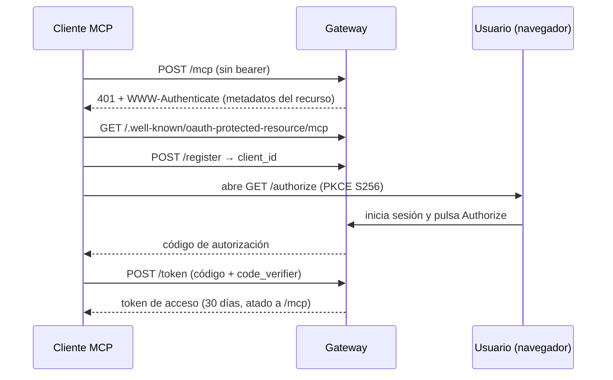

# Autenticación

El gateway acepta tres credenciales en los mismos endpoints:

| Credencial | Para | Cómo |
|---|---|---|
| **API key** | Scripts, servidores, CI | `Authorization: Bearer sk_live_…` |
| **Token de acceso OAuth 2.0** | Conectores MCP (Claude, ChatGPT, `kiba-mcp`) | `Authorization: Bearer <token>` obtenido con PKCE |
| **Cookie de sesión** | El dashboard | La fija el formulario de inicio de sesión |

## API keys

Créalas en el dashboard (**Credentials**) o por API:

```bash
curl -X POST https://api.kiba.tools/v1/api-keys \
  -H "Authorization: Bearer $KIBA_TOKEN" \
  -H "Content-Type: application/json" \
  -d '{"name":"my-script"}'
```

:::warning[Se muestra una sola vez]
La clave en claro se devuelve **una sola vez**; el gateway guarda solo un hash (SHA-256). Guárdala al crearla.
:::

Revoca con `DELETE /v1/api-keys/:id`. No expiran.

## OAuth 2.0 (conectores)

El gateway es un servidor de autorización OAuth 2.0 con PKCE (S256) y registro dinámico de clientes, así que los clientes MCP se configuran solos desde la URL del conector:

| Endpoint | Estándar | Para qué |
|---|---|---|
| `/.well-known/oauth-protected-resource/mcp` | RFC 9728 | Apunta el recurso `/mcp` a su servidor de autorización |
| `/.well-known/oauth-authorization-server` | RFC 8414 | Lista `authorize`, `token`, `register` y métodos soportados |
| `POST /register` | RFC 7591 | Los clientes se auto-registran y reciben un `client_id` |
| `GET /authorize` | OAuth 2.1 + PKCE | Pantalla de inicio de sesión y consentimiento |
| `POST /token` | OAuth 2.1 + PKCE | Cambia el código por un token de acceso |
| `POST /revoke` | RFC 7009 | Revoca un token |



- Una petición a `/mcp` sin bearer devuelve `401` con un header `WWW-Authenticate` que apunta a los metadatos del recurso: así empieza el flujo un cliente.
- Los tokens están atados al recurso `/mcp` (RFC 8707) y duran **30 días**.
- Las apps autorizadas se listan en `GET /v1/oauth/connections` y se desconectan con `DELETE /v1/oauth/connections/:id`.

`POST /mcp` es el servidor MCP remoto (Streamable HTTP) detrás de este flujo; expone las cuatro [herramientas](/conecta-tu-asistente/herramientas-mcp).
