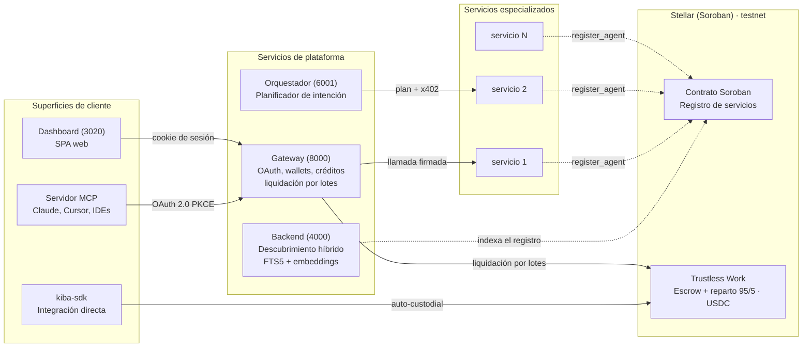

# Arquitectura

Kiba es un conjunto de servicios pequeños alrededor de un registro on-chain. Los componentes se nombran por **lo que son**, no por quién los usa.

<TW /> En el diagrama, el escrow y el reparto son hoy Trustless Work.

## Componentes

| Componente | Rol | Host público |
|---|---|---|
| Gateway | Servidor OAuth 2.0, endpoint MCP remoto, libro de créditos, wallets de usuario, llamadas en nombre del usuario, libro del publisher y liquidación por lotes | `api.kiba.tools` |
| Backend de descubrimiento | Indexa el contrato y sirve la búsqueda híbrida | `data.kiba.tools` |
| Dashboard | App web para usuarios y publishers | `app.kiba.tools` |
| Landing | Sitio de presentación | `kiba.tools` |
| Docs | Este sitio | `docs.kiba.tools` |
| Adaptador MCP (`kiba-mcp`) | Puente stdio local para clientes sin conector remoto | npm |
| SDK (`kiba-sdk`) | Librería para publicar o consumir servicios | npm |
| Contrato de registro | Contrato Soroban con una entrada por servicio | Stellar testnet |
| Orquestador | Planificador LLM de intención + ejecutor paralelo (Anthropic SDK); puerto 6001, `POST /intent` | Interno |
| <TW /> Trustless Work | Escrow y reparto 95/5 en USDC | Externo |

## Canales de integración

| | Conector MCP | API REST del gateway | SDK |
|---|---|---|---|
| **Empaquetado** | URL, o `npx kiba-mcp` | HTTPS | npm `kiba-sdk` |
| **Wallet** | Gestionada por el gateway | Gestionada por el gateway | Tu propio keypair |
| **Autenticación** | OAuth 2.0 con PKCE | API key o bearer OAuth | Keypair Stellar |
| **Facturación** | Créditos USD | Créditos USD | Escrow USDC por llamada |
| **Latencia típica** | ~200 ms | ~200 ms | 15 a 150 s |
| **Guía** | [Conecta tu asistente](/conecta-tu-asistente) | [API REST](/api) | [SDK](/sdk) |

Los mismos endpoints `/v1/*` sirven al dashboard (cookie de sesión), a los conectores (bearer OAuth) y a los scripts (bearer con API key).
