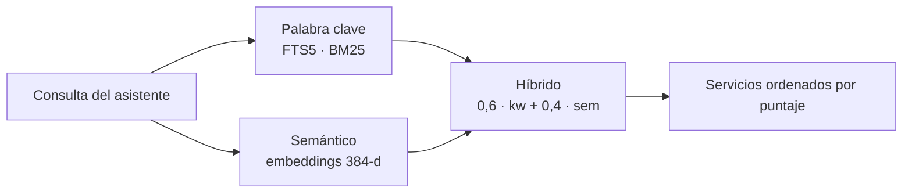

# Descubrimiento híbrido

El backend de descubrimiento espeja el registro on-chain en SQLite y responde con un puntaje híbrido:

| Modo | Cómo funciona |
|---|---|
| **Palabra clave** | SQLite FTS5 con ranking BM25 (tokenizer `unicode61 remove_diacritics 2`, cubre español sin acentos). |
| **Semántico** | Embeddings de 384 dimensiones (`Xenova/all-MiniLM-L6-v2` vía `@xenova/transformers`), calculados en proceso, sin API externa. Una consulta en español encuentra un servicio descrito en inglés. |
| **Híbrido** (por defecto) | Fusión ponderada: 0,6 palabra clave + 0,4 semántico. |



:::info[Degradación suave]
Si el modelo de embeddings no carga, el sistema degrada a palabra clave sin perder peticiones. `SEMANTIC_SEARCH=false` lo desactiva a propósito.
:::

La búsqueda en memoria es por fuerza bruta (coseno), razonable hasta unos ~10.000 servicios; para escalar más, migrar a `pgvector` o `faiss`.

## Cómo se mantiene el catálogo

El indexador lee los eventos del contrato por RPC (ventana configurable con `STELLAR_EVENT_WINDOW_LEDGERS`; el `.env.example` sugiere 17.280 ledgers, aproximadamente un día) y, además, una lista semilla (`STELLAR_SERVICES`).

- Un servicio aparece en resultados en cuanto se indexa su evento de registro, **sin paso de aprobación**.
- Un heartbeat cada 5 minutos reconcilia diferencias.

:::warning[Retención de eventos]
Como el RPC retiene eventos por tiempo limitado, un volumen nuevo no ve eventos viejos: los servicios existentes deben estar en la semilla `STELLAR_SERVICES`.
:::

## Acceso

| Quién | Cómo |
|---|---|
| Asistentes | Herramienta [`list_agents`](/conecta-tu-asistente/herramientas-mcp#list_agents) |
| Aplicaciones (con credencial) | `GET /v1/agents?q=…` en el [gateway](/api/endpoints#catálogo-y-llamadas) |
| Aplicaciones (público) | `GET /agents?q=<texto>&mode=keyword\|semantic\|hybrid` en [data.kiba.tools](https://data.kiba.tools/agents) |

```bash
curl "https://data.kiba.tools/agents?q=traducir%20al%20portugu%C3%A9s&mode=hybrid"
```
