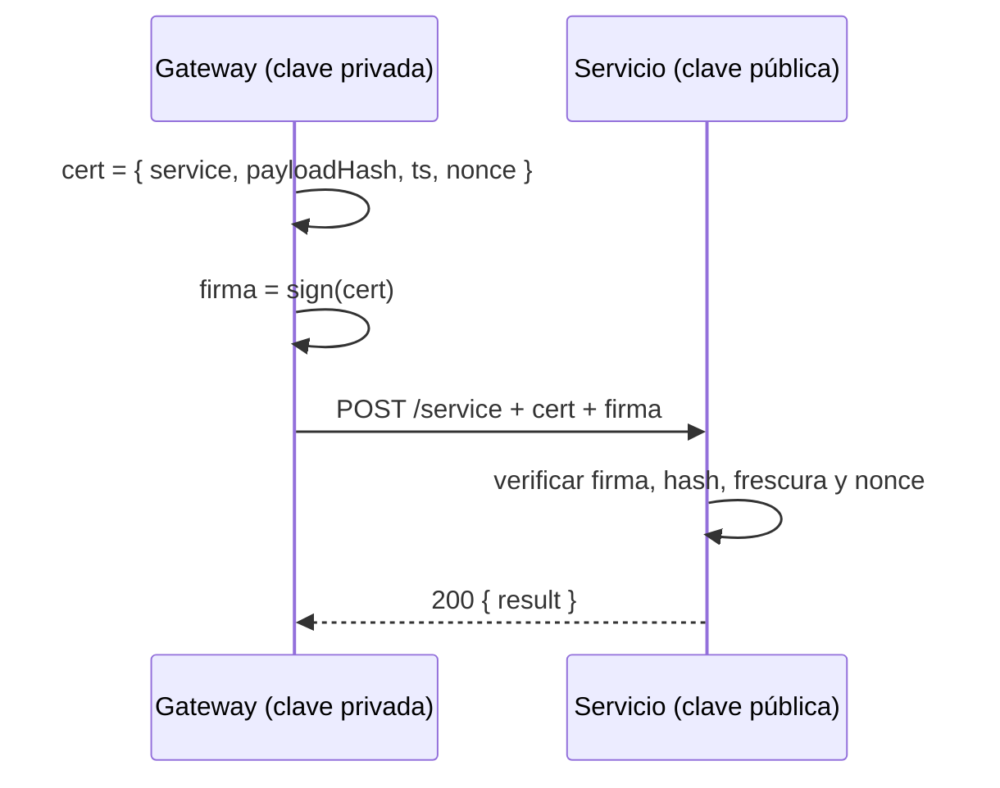

# Modelo de confianza

La plataforma prueba una llamada pagada ante un servicio con una **firma asimétrica**:

- La plataforma guarda una clave **privada** ed25519 que nunca revela.
- Cada servicio se configura con la clave **pública** de la plataforma (`platform.publicKey`, dirección Stellar `G…`, segura de publicar).
- Por cada llamada, la plataforma crea un certificado corto `{ service, payloadHash, ts, nonce }` y lo firma. El servicio verifica:
  - la firma;
  - que el hash coincida con el cuerpo recibido;
  - que el certificado sea reciente (el reloj no puede desviarse más de ~2 minutos);
  - que el nonce no se haya repetido.

:::tip[Por qué asimétrica]
Como lo que guarda un servicio (una clave pública) no puede emitir llamadas, filtrar la configuración de un servicio **nunca** permite suplantar a la plataforma ante otros.
:::

## Sin confiar en ninguna plataforma

Quien llama sin confiar en ninguna plataforma usa la ruta **escrow x402** (la predeterminada de `call()`): el servicio revisa el escrow on-chain y lo libera tras atender. Más lenta, pero sin parte de confianza. Ver [Pagos y liquidación](/conceptos/pagos-y-liquidacion#llamada-con-escrow-directo-sdk).

Si operas tu propio gateway, firmas los certificados tú mismo: ver [Operar tu propia plataforma](/sdk/operar-tu-plataforma).
