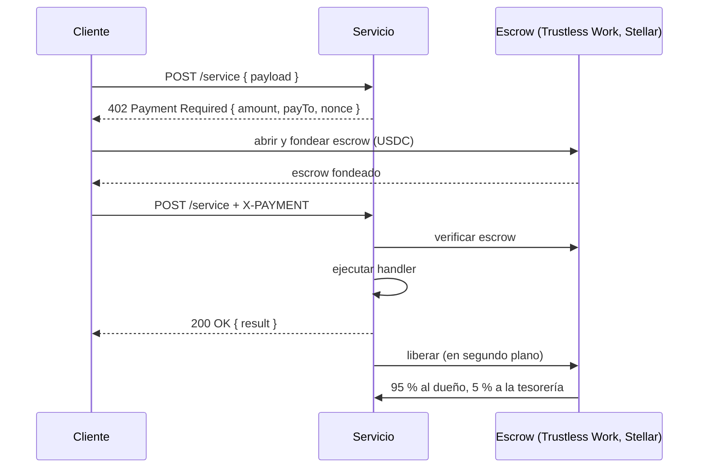

# Pagos y liquidación

Kiba usa el patrón **x402**: una petición HTTP recibe `402 Payment Required` con una cotización, quien llama paga y reintenta con prueba de pago. El reparto se escala con el monto cotizado, así que el precio dinámico funciona sin configuración extra.

## Dos rutas de pago

| Ruta | Quién la usa | Velocidad | Confianza |
|---|---|---|---|
| **Firmada por la plataforma** (vía gateway) | Asistentes y usuarios del dashboard que pagan con créditos | Cientos de ms (~170 ms medido en testnet) | El servicio verifica la firma de la plataforma; las ganancias se liquidan por lotes |
| **Escrow x402 directo** | Clientes del SDK que pagan desde su propia wallet | 15 a 150 s | Totalmente sin confianza, on-chain |

### Llamada firmada por la plataforma

1. El gateway debita los créditos del usuario.
2. Llama al servicio con un certificado corto firmado: nombre del servicio, hash del payload, marca de tiempo y nonce. El servicio verifica la firma con la clave **pública** de la plataforma; nunca viaja un secreto compartido.
3. El servicio responde. El gateway registra la ganancia en el libro del publisher. Si el servicio falla, el débito se reembolsa.
4. <TW /> El gateway fondea el **escrow de liquidación** vigente del publisher en Trustless Work con el monto de la llamada. La respuesta incluye un enlace del explorador a esa transacción.
5. Periódicamente se **liquida** el ciclo. <TW /> Se libera el escrow y se barre el saldo a la wallet del publisher; Trustless Work aplica la comisión de plataforma al liberar.

### Llamada con escrow directo (SDK)

El cliente abre y fondea un escrow de liberación única que nombra al servicio como receptor, llama al servicio con el id del escrow en el header `X-PAYMENT` y el servicio libera los fondos tras atender. **Cada escrow se atiende una sola vez.**

<TW /> En el diagrama, el escrow es hoy Trustless Work.

## El reparto 95/5

`platformFee = 5` (equivale a 500 bps): por cada llamada, **95 % al dueño del servicio y 5 % a la tesorería de Kiba**.

## Liquidación por lotes (gateway)

- **Monto mínimo para liquidar:** 1 USDC por defecto (`SETTLEMENT_MIN_PAYOUT`, 10.000.000 unidades base), para evitar polvo.
- **Liquidación automática (cron):** solo corre para servicios cuyo dueño activó el opt-in; el resto se liquida bajo demanda con [`POST /v1/publisher/settle`](/api/endpoints#publisher).
- **Sin dobles pagos:** el claim marca las filas con un `settlement_id` antes de pagar on-chain. Llamadas concurrentes no se liquidan dos veces y un pago fallido libera las filas para reintentar.
- **Interruptor de emergencia:** `SETTLE_SWEEP=0` vuelve a la liquidación clásica.

## Lo que ve el publisher

Ganancias y liquidaciones aparecen en el [panel del dashboard](/publica-un-servicio/panel-de-publisher) y en `GET /v1/publisher/{overview,settlements,analytics}`, siempre **netas** de comisión. El pago llega a la cuenta Stellar **dueña del registro on-chain**.
