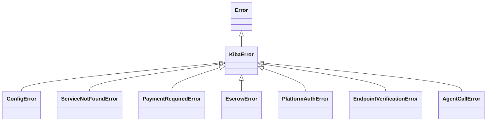

# Errores del SDK

Todo error que el SDK lanza a propósito es una instancia de **`KibaError`**, así que puedes capturar el error base y ramificar según la subclase concreta. Los mensajes están en inglés y son estables para comparar.



## Catálogo

| Clase | Cuándo ocurre | Campos extra | Qué hacer |
|---|---|---|---|
| `ConfigError` | Configuración inválida o incompleta (falta `contractId`, dirección de plataforma vacía…) | — | Revisa las opciones y variables de [Configuración](/sdk/configuracion). |
| `ServiceNotFoundError` | El servicio no está en el registro ni en el backend de descubrimiento | `service` | Verifica el nombre y que el servicio esté registrado. |
| `PaymentRequiredError` | El provider rechazó la petición porque faltaba el pago o era insuficiente | — | Repite la llamada con `call()`, que resuelve el handshake x402. |
| `EscrowError` | Falló una operación de escrow (abrir, fondear, liberar, reembolsar) o el escrow no cumple las reglas de vinculación (receptor equivocado, ya consumido, fondos insuficientes) | `recoverable`, `service`, `escrowId`, `nonce` | Si `recoverable` es `true`, los fondos pueden estar bloqueados y se recuperan con el flujo de disputa. <TW /> |
| `PlatformAuthError` | No se pudo verificar una llamada firmada por la plataforma | `reason` | Mira `reason` (tabla abajo). |
| `EndpointVerificationError` | El `/manifest` del endpoint reporta otro servicio u otro dueño que el registro on-chain | `service` | No llames a ese endpoint. Ver [Nombres y confianza](/publica-un-servicio/nombres-y-confianza#verificación-de-endpoint). |
| `AgentCallError` | Falló la llamada al servicio remoto (error de transporte, respuesta no 2xx, timeout) | `service`, `status` | Revisa el payload contra la descripción del servicio y reintenta si es transitorio. |

## Motivos de `PlatformAuthError`

| `reason` | Significado |
|---|---|
| `missing` | La petición no trae los headers de firma de plataforma |
| `malformed` | Los headers no tienen el formato esperado |
| `bad-signature` | La firma no corresponde a la clave pública configurada |
| `wrong-service` | El certificado es para otro servicio |
| `payload-mismatch` | El hash del certificado no coincide con el cuerpo recibido |
| `expired` | El certificado venció; revisa que el reloj del host esté a ~2 minutos de la hora real |
| `replayed` | El nonce ya se usó |
| `not-configured` | El provider no tiene `platform.publicKey` configurada |

## Ejemplo

```ts
import {
  KibaError,
  ServiceNotFoundError,
  EscrowError,
  AgentCallError,
} from 'kiba-sdk';

try {
  await client.call('translator-pro', { text: 'hello' });
} catch (err) {
  if (err instanceof ServiceNotFoundError) {
    console.error(`No existe el servicio ${err.service}`);
  } else if (err instanceof EscrowError && err.recoverable) {
    console.error(`Fondos bloqueados en el escrow ${err.escrowId}`);
  } else if (err instanceof AgentCallError) {
    console.error(`El servicio respondió ${err.status}`);
  } else if (err instanceof KibaError) {
    console.error(err.name, err.message);
  } else {
    throw err;
  }
}
```

Los errores de la API REST del gateway son distintos: ver [Errores de la API](/api/errores).
