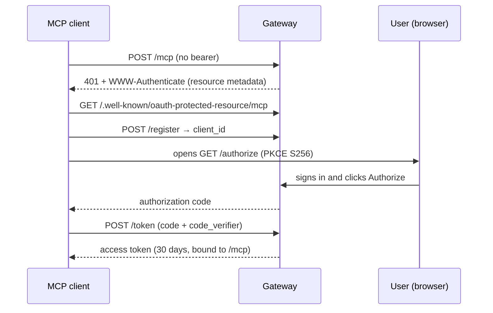

# Authentication

The gateway accepts three credentials on the same endpoints:

| Credential | For | How |
|---|---|---|
| **API key** | Scripts, servers, CI | `Authorization: Bearer sk_live_…` |
| **OAuth 2.0 access token** | MCP connectors (Claude, ChatGPT, `kiba-mcp`) | `Authorization: Bearer <token>` obtained with PKCE |
| **Session cookie** | The dashboard | Set by the sign-in form |

## API keys {/* #api-keys */}

Create them in the dashboard (**Credentials**) or via the API:

```bash
curl -X POST https://api.kiba.tools/v1/api-keys \
  -H "Authorization: Bearer $KIBA_TOKEN" \
  -H "Content-Type: application/json" \
  -d '{"name":"my-script"}'
```

:::warning[Shown only once]
The plaintext key is returned **only once**; the gateway stores only a hash (SHA-256). Save it when you create it.
:::

Revoke with `DELETE /v1/api-keys/:id`. They don't expire.

## OAuth 2.0 (connectors) {/* #oauth-20-conectores */}

The gateway is an OAuth 2.0 authorization server with PKCE (S256) and dynamic client registration, so MCP clients configure themselves from the connector URL:

| Endpoint | Standard | Purpose |
|---|---|---|
| `/.well-known/oauth-protected-resource/mcp` | RFC 9728 | Points the `/mcp` resource to its authorization server |
| `/.well-known/oauth-authorization-server` | RFC 8414 | Lists `authorize`, `token`, `register` and supported methods |
| `POST /register` | RFC 7591 | Clients self-register and get a `client_id` |
| `GET /authorize` | OAuth 2.1 + PKCE | Sign-in and consent screen |
| `POST /token` | OAuth 2.1 + PKCE | Exchanges the code for an access token |
| `POST /revoke` | RFC 7009 | Revokes a token |



- A request to `/mcp` without a bearer returns `401` with a `WWW-Authenticate` header pointing to the resource metadata: that's how a client starts the flow.
- Tokens are bound to the `/mcp` resource (RFC 8707) and last **30 days**.
- Authorized apps are listed in `GET /v1/oauth/connections` and disconnected with `DELETE /v1/oauth/connections/:id`.

`POST /mcp` is the remote MCP server (Streamable HTTP) behind this flow; it exposes the four [tools](/conecta-tu-asistente/herramientas-mcp).
