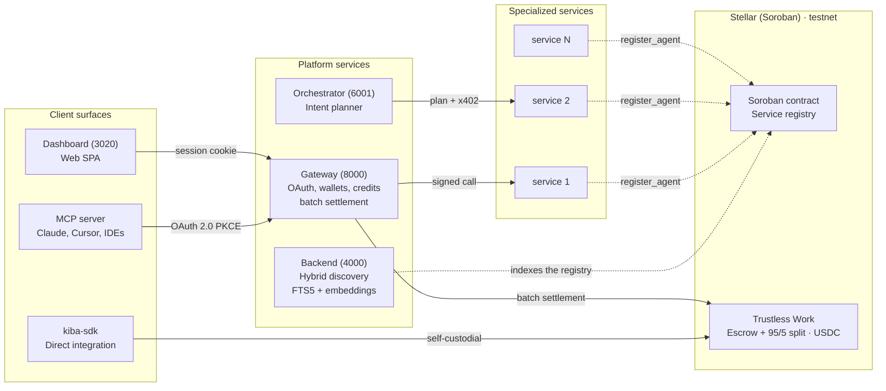

# Architecture

Kiba is a set of small services around an on-chain registry. Components are named for **what they are**, not for who uses them.

<TW /> In the diagram, the escrow and the split are Trustless Work today.

## Components

| Component | Role | Public host |
|---|---|---|
| Gateway | OAuth 2.0 server, remote MCP endpoint, credit ledger, user wallets, calls on the user's behalf, publisher ledger and batch settlement | `api.kiba.tools` |
| Discovery backend | Indexes the contract and serves hybrid search | `data.kiba.tools` |
| Dashboard | Web app for users and publishers | `app.kiba.tools` |
| Landing | Marketing site | `kiba.tools` |
| Docs | This site | `docs.kiba.tools` |
| MCP adapter (`kiba-mcp`) | Local stdio bridge for clients without a remote connector | npm |
| SDK (`kiba-sdk`) | Library to publish or consume services | npm |
| Registry contract | Soroban contract with one entry per service | Stellar testnet |
| Orchestrator | LLM intent planner + parallel executor (Anthropic SDK); port 6001, `POST /intent` | Internal |
| <TW /> Trustless Work | Escrow and 95/5 split in USDC | External |

## Integration channels

| | MCP connector | Gateway REST API | SDK |
|---|---|---|---|
| **Packaging** | URL, or `npx kiba-mcp` | HTTPS | npm `kiba-sdk` |
| **Wallet** | Managed by the gateway | Managed by the gateway | Your own keypair |
| **Authentication** | OAuth 2.0 with PKCE | API key or OAuth bearer | Stellar keypair |
| **Billing** | USD credits | USD credits | USDC escrow per call |
| **Typical latency** | ~200 ms | ~200 ms | 15 to 150 s |
| **Guide** | [Connect your assistant](/conecta-tu-asistente) | [REST API](/api) | [SDK](/sdk) |

The same `/v1/*` endpoints serve the dashboard (session cookie), the connectors (OAuth bearer) and scripts (API key bearer).
