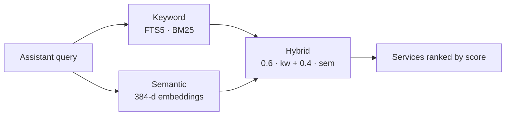

# Hybrid discovery

The discovery backend mirrors the on-chain registry into SQLite and answers with a hybrid score:

| Mode | How it works |
|---|---|
| **Keyword** | SQLite FTS5 with BM25 ranking (`unicode61 remove_diacritics 2` tokenizer, handles Spanish without accents). |
| **Semantic** | 384-dimensional embeddings (`Xenova/all-MiniLM-L6-v2` via `@xenova/transformers`), computed in-process, no external API. A query in Spanish finds a service described in English. |
| **Hybrid** (default) | Weighted fusion: 0.6 keyword + 0.4 semantic. |



:::info[Graceful degradation]
If the embeddings model doesn't load, the system falls back to keyword search without dropping requests. `SEMANTIC_SEARCH=false` disables it on purpose.
:::

In-memory search is brute force (cosine), reasonable up to ~10,000 services; to scale further, migrate to `pgvector` or `faiss`.

## How the catalog stays fresh {/* #cómo-se-mantiene-el-catálogo */}

The indexer reads contract events over RPC (configurable window with `STELLAR_EVENT_WINDOW_LEDGERS`; `.env.example` suggests 17,280 ledgers, roughly one day) plus a seed list (`STELLAR_SERVICES`).

- A service shows up in results as soon as its registration event is indexed, **with no approval step**.
- A heartbeat every 5 minutes reconciles differences.

:::warning[Event retention]
Since RPC keeps events for a limited time, a new volume doesn't see old events: existing services must be in the `STELLAR_SERVICES` seed.
:::

## Access

| Who | How |
|---|---|
| Assistants | [`list_agents`](/conecta-tu-asistente/herramientas-mcp#list_agents) tool |
| Applications (with credential) | `GET /v1/agents?q=…` on the [gateway](/api/endpoints#catálogo-y-llamadas) |
| Applications (public) | `GET /agents?q=<text>&mode=keyword\|semantic\|hybrid` on [data.kiba.tools](https://data.kiba.tools/agents) |

```bash
curl "https://data.kiba.tools/agents?q=translate%20to%20portuguese&mode=hybrid"
```
