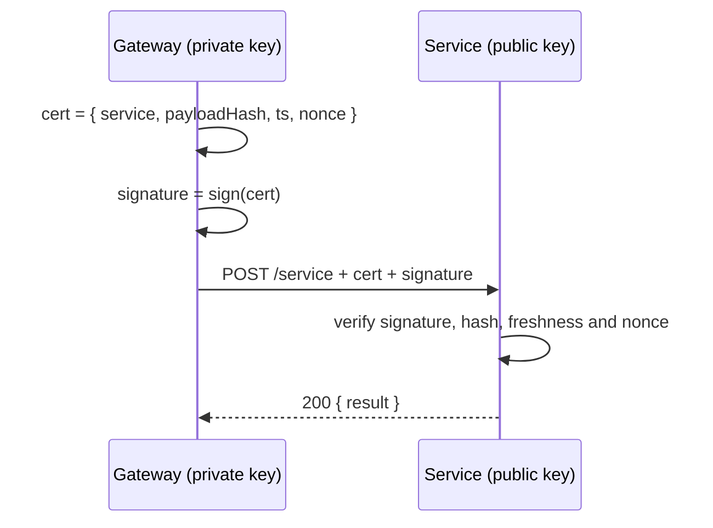

# Trust model

The platform proves a paid call to a service with an **asymmetric signature**:

- The platform holds an ed25519 **private** key it never reveals.
- Every service is configured with the platform's **public** key (`platform.publicKey`, a Stellar `G…` address, safe to publish).
- For every call, the platform creates a short certificate `{ service, payloadHash, ts, nonce }` and signs it. The service verifies:
  - the signature;
  - that the hash matches the received body;
  - that the certificate is fresh (the clock can't drift more than ~2 minutes);
  - that the nonce hasn't been used before.

:::tip[Why asymmetric]
Since what a service holds (a public key) can't mint calls, leaking a service's configuration **never** lets anyone impersonate the platform to other services.
:::

## Without trusting any platform

Callers who don't trust any platform use the **x402 escrow** path (the default for `call()`): the service checks the escrow on-chain and releases it after serving. Slower, but with no trusted party. See [Payments and settlement](/conceptos/pagos-y-liquidacion#llamada-con-escrow-directo-sdk).

If you run your own gateway, you sign the certificates yourself: see [Run your own platform](/sdk/operar-tu-plataforma).
