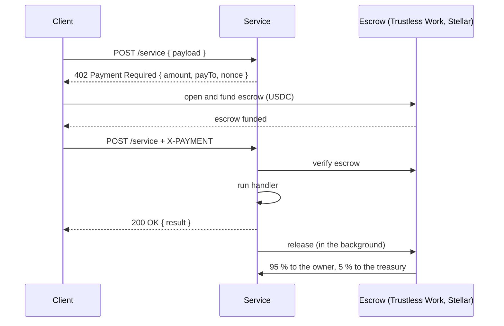

# Payments and settlement

Kiba uses the **x402** pattern: an HTTP request gets `402 Payment Required` with a quote, the caller pays and retries with proof of payment. The split scales with the quoted amount, so dynamic pricing works with no extra setup.

## Two payment paths

| Path | Who uses it | Speed | Trust |
|---|---|---|---|
| **Platform-signed** (via gateway) | Assistants and dashboard users paying with credits | Hundreds of ms (~170 ms measured on testnet) | The service verifies the platform's signature; earnings settle in batches |
| **Direct x402 escrow** | SDK clients paying from their own wallet | 15 to 150 s | Fully trustless, on-chain |

### Platform-signed call

1. The gateway debits the user's credits.
2. It calls the service with a short signed certificate: service name, payload hash, timestamp and nonce. The service verifies the signature with the platform's **public** key; no shared secret ever travels.
3. The service responds. The gateway records the earning in the publisher's ledger. If the service fails, the debit is refunded.
4. <TW /> The gateway funds the publisher's current **settlement escrow** on Trustless Work with the call amount. The response includes an explorer link to that transaction.
5. Periodically the cycle is **settled**. <TW /> The escrow is released and the balance is swept to the publisher's wallet; Trustless Work applies the platform fee on release.

### Direct escrow call (SDK) {/* #llamada-con-escrow-directo-sdk */}

The client opens and funds a single-release escrow naming the service as receiver, calls the service with the escrow id in the `X-PAYMENT` header, and the service releases the funds after serving. **Each escrow is served only once.**

<TW /> In the diagram, the escrow is Trustless Work today.

## The 95/5 split

`platformFee = 5` (equivalent to 500 bps): for every call, **95 % goes to the service owner and 5 % to the Kiba treasury**.

## Batch settlement (gateway) {/* #liquidación-por-lotes-gateway */}

- **Minimum payout:** 1 USDC by default (`SETTLEMENT_MIN_PAYOUT`, 10,000,000 base units), to avoid dust.
- **Automatic settlement (cron):** only runs for services whose owner opted in; the rest settle on demand with [`POST /v1/publisher/settle`](/api/endpoints#publisher).
- **No double payouts:** the claim tags rows with a `settlement_id` before paying on-chain. Concurrent calls aren't settled twice and a failed payout frees the rows for retry.
- **Kill switch:** `SETTLE_SWEEP=0` falls back to classic settlement.

## What the publisher sees

Earnings and settlements show up in the [dashboard panel](/publica-un-servicio/panel-de-publisher) and in `GET /v1/publisher/{overview,settlements,analytics}`, always **net** of fees. The payout reaches the Stellar account that **owns the on-chain registration**.
