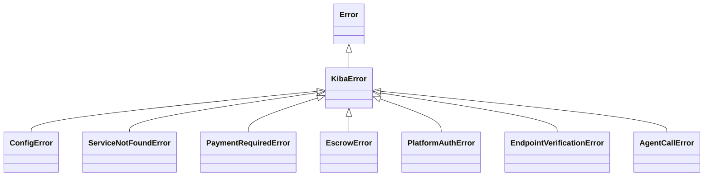

# SDK errors

Every error the SDK throws on purpose is an instance of **`KibaError`**, so you can catch the base error and branch on the concrete subclass. Messages are in English and stable enough to match on.



## Catalog

| Class | When it happens | Extra fields | What to do |
|---|---|---|---|
| `ConfigError` | Invalid or incomplete configuration (missing `contractId`, empty platform address…) | — | Check the options and variables in [Configuration](/sdk/configuracion). |
| `ServiceNotFoundError` | The service isn't in the registry or the discovery backend | `service` | Check the name and that the service is registered. |
| `PaymentRequiredError` | The provider rejected the request because payment was missing or insufficient | — | Retry with `call()`, which handles the x402 handshake. |
| `EscrowError` | An escrow operation failed (open, fund, release, refund) or the escrow breaks the binding rules (wrong receiver, already consumed, under-funded) | `recoverable`, `service`, `escrowId`, `nonce` | If `recoverable` is `true`, funds may be locked and are recovered through the dispute flow. <TW /> |
| `PlatformAuthError` | A platform-signed call couldn't be verified | `reason` | Check `reason` (table below). |
| `EndpointVerificationError` | The endpoint's `/manifest` reports a different service or owner than the on-chain registration | `service` | Don't call that endpoint. See [Names and trust](/publica-un-servicio/nombres-y-confianza#verificación-de-endpoint). |
| `AgentCallError` | The call to the remote service failed (transport error, non-2xx response, timeout) | `service`, `status` | Check the payload against the service description and retry if it's transient. |

## `PlatformAuthError` reasons

| `reason` | Meaning |
|---|---|
| `missing` | The request has no platform signature headers |
| `malformed` | The headers don't have the expected format |
| `bad-signature` | The signature doesn't match the configured public key |
| `wrong-service` | The certificate is for another service |
| `payload-mismatch` | The certificate hash doesn't match the received body |
| `expired` | The certificate expired; check that the host clock is within ~2 minutes of real time |
| `replayed` | The nonce was already used |
| `not-configured` | The provider has no `platform.publicKey` configured |

## Example

```ts
import {
  KibaError,
  ServiceNotFoundError,
  EscrowError,
  AgentCallError,
} from 'kiba-sdk';

try {
  await client.call('translator-pro', { text: 'hello' });
} catch (err) {
  if (err instanceof ServiceNotFoundError) {
    console.error(`Service ${err.service} doesn't exist`);
  } else if (err instanceof EscrowError && err.recoverable) {
    console.error(`Funds locked in escrow ${err.escrowId}`);
  } else if (err instanceof AgentCallError) {
    console.error(`The service answered ${err.status}`);
  } else if (err instanceof KibaError) {
    console.error(err.name, err.message);
  } else {
    throw err;
  }
}
```

Gateway REST API errors are different: see [API errors](/api/errores).
