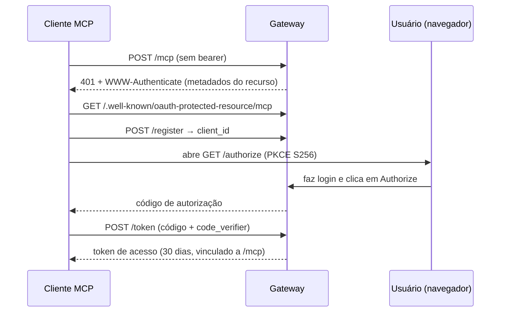

# Autenticação

O gateway aceita três credenciais nos mesmos endpoints:

| Credencial | Para | Como |
|---|---|---|
| **API key** | Scripts, servidores, CI | `Authorization: Bearer sk_live_…` |
| **Token de acesso OAuth 2.0** | Conectores MCP (Claude, ChatGPT, `kiba-mcp`) | `Authorization: Bearer <token>` obtido com PKCE |
| **Cookie de sessão** | O dashboard | Definido pelo formulário de login |

## API keys {/* #api-keys */}

Crie-as no dashboard (**Credentials**) ou pela API:

```bash
curl -X POST https://api.kiba.tools/v1/api-keys \
  -H "Authorization: Bearer $KIBA_TOKEN" \
  -H "Content-Type: application/json" \
  -d '{"name":"my-script"}'
```

:::warning[Exibida uma única vez]
A chave em texto puro é devolvida **uma única vez**; o gateway guarda só um hash (SHA-256). Guarde-a ao criá-la.
:::

Revogue com `DELETE /v1/api-keys/:id`. Elas não expiram.

## OAuth 2.0 (conectores) {/* #oauth-20-conectores */}

O gateway é um servidor de autorização OAuth 2.0 com PKCE (S256) e registro dinâmico de clientes, então os clientes MCP se configuram sozinhos a partir da URL do conector:

| Endpoint | Padrão | Para quê |
|---|---|---|
| `/.well-known/oauth-protected-resource/mcp` | RFC 9728 | Aponta o recurso `/mcp` para o seu servidor de autorização |
| `/.well-known/oauth-authorization-server` | RFC 8414 | Lista `authorize`, `token`, `register` e os métodos suportados |
| `POST /register` | RFC 7591 | Os clientes se registram sozinhos e recebem um `client_id` |
| `GET /authorize` | OAuth 2.1 + PKCE | Tela de login e consentimento |
| `POST /token` | OAuth 2.1 + PKCE | Troca o código por um token de acesso |
| `POST /revoke` | RFC 7009 | Revoga um token |



- Uma requisição a `/mcp` sem bearer devolve `401` com um header `WWW-Authenticate` que aponta para os metadados do recurso: é assim que um cliente inicia o fluxo.
- Os tokens ficam vinculados ao recurso `/mcp` (RFC 8707) e duram **30 dias**.
- Os apps autorizados são listados em `GET /v1/oauth/connections` e desconectados com `DELETE /v1/oauth/connections/:id`.

`POST /mcp` é o servidor MCP remoto (Streamable HTTP) por trás desse fluxo; ele expõe as quatro [ferramentas](/conecta-tu-asistente/herramientas-mcp).
