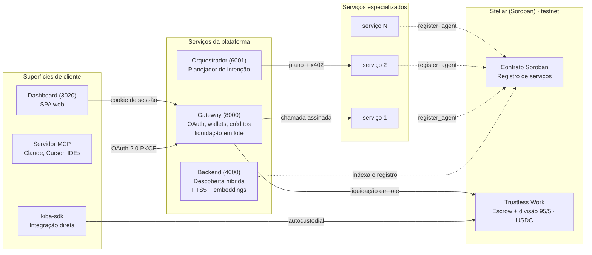

# Arquitetura

A Kiba é um conjunto de serviços pequenos em volta de um registro on-chain. Os componentes recebem o nome do **que são**, não de quem os usa.

<TW /> No diagrama, o escrow e a divisão hoje são a Trustless Work.

## Componentes

| Componente | Papel | Host público |
|---|---|---|
| Gateway | Servidor OAuth 2.0, endpoint MCP remoto, livro de créditos, wallets de usuário, chamadas em nome do usuário, livro do publisher e liquidação em lote | `api.kiba.tools` |
| Backend de descoberta | Indexa o contrato e serve a busca híbrida | `data.kiba.tools` |
| Dashboard | App web para usuários e publishers | `app.kiba.tools` |
| Landing | Site de apresentação | `kiba.tools` |
| Docs | Este site | `docs.kiba.tools` |
| Adaptador MCP (`kiba-mcp`) | Ponte stdio local para clientes sem conector remoto | npm |
| SDK (`kiba-sdk`) | Biblioteca para publicar ou consumir serviços | npm |
| Contrato de registro | Contrato Soroban com uma entrada por serviço | Stellar testnet |
| Orquestrador | Planejador LLM de intenção + executor paralelo (Anthropic SDK); porta 6001, `POST /intent` | Interno |
| <TW /> Trustless Work | Escrow e divisão 95/5 em USDC | Externo |

## Canais de integração

| | Conector MCP | API REST do gateway | SDK |
|---|---|---|---|
| **Empacotamento** | URL, ou `npx kiba-mcp` | HTTPS | npm `kiba-sdk` |
| **Wallet** | Gerenciada pelo gateway | Gerenciada pelo gateway | Seu próprio keypair |
| **Autenticação** | OAuth 2.0 com PKCE | API key ou bearer OAuth | Keypair Stellar |
| **Cobrança** | Créditos em USD | Créditos em USD | Escrow em USDC por chamada |
| **Latência típica** | ~200 ms | ~200 ms | 15 a 150 s |
| **Guia** | [Conecte seu assistente](/conecta-tu-asistente) | [API REST](/api) | [SDK](/sdk) |

Os mesmos endpoints `/v1/*` atendem o dashboard (cookie de sessão), os conectores (bearer OAuth) e os scripts (bearer com API key).
