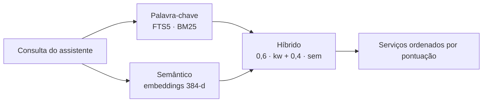

# Descoberta híbrida

O backend de descoberta espelha o registro on-chain no SQLite e responde com uma pontuação híbrida:

| Modo | Como funciona |
|---|---|
| **Palavra-chave** | SQLite FTS5 com ranking BM25 (tokenizer `unicode61 remove_diacritics 2`, cobre espanhol sem acentos). |
| **Semântico** | Embeddings de 384 dimensões (`Xenova/all-MiniLM-L6-v2` via `@xenova/transformers`), calculados no próprio processo, sem API externa. Uma consulta em espanhol encontra um serviço descrito em inglês. |
| **Híbrido** (padrão) | Fusão ponderada: 0,6 palavra-chave + 0,4 semântico. |



:::info[Degradação suave]
Se o modelo de embeddings não carregar, o sistema volta para palavra-chave sem perder requisições. `SEMANTIC_SEARCH=false` o desativa de propósito.
:::

A busca em memória é por força bruta (cosseno), razoável até uns ~10.000 serviços; para escalar mais, migre para `pgvector` ou `faiss`.

## Como o catálogo se mantém atualizado {/* #cómo-se-mantiene-el-catálogo */}

O indexador lê os eventos do contrato via RPC (janela configurável com `STELLAR_EVENT_WINDOW_LEDGERS`; o `.env.example` sugere 17.280 ledgers, cerca de um dia) e, além disso, uma lista semente (`STELLAR_SERVICES`).

- Um serviço aparece nos resultados assim que seu evento de registro é indexado, **sem etapa de aprovação**.
- Um heartbeat a cada 5 minutos reconcilia diferenças.

:::warning[Retenção de eventos]
Como o RPC retém eventos por tempo limitado, um volume novo não vê eventos antigos: os serviços existentes precisam estar na semente `STELLAR_SERVICES`.
:::

## Acesso

| Quem | Como |
|---|---|
| Assistentes | Ferramenta [`list_agents`](/conecta-tu-asistente/herramientas-mcp#list_agents) |
| Aplicações (com credencial) | `GET /v1/agents?q=…` no [gateway](/api/endpoints#catálogo-y-llamadas) |
| Aplicações (público) | `GET /agents?q=<texto>&mode=keyword\|semantic\|hybrid` em [data.kiba.tools](https://data.kiba.tools/agents) |

```bash
curl "https://data.kiba.tools/agents?q=traduzir%20para%20o%20portugu%C3%AAs&mode=hybrid"
```
