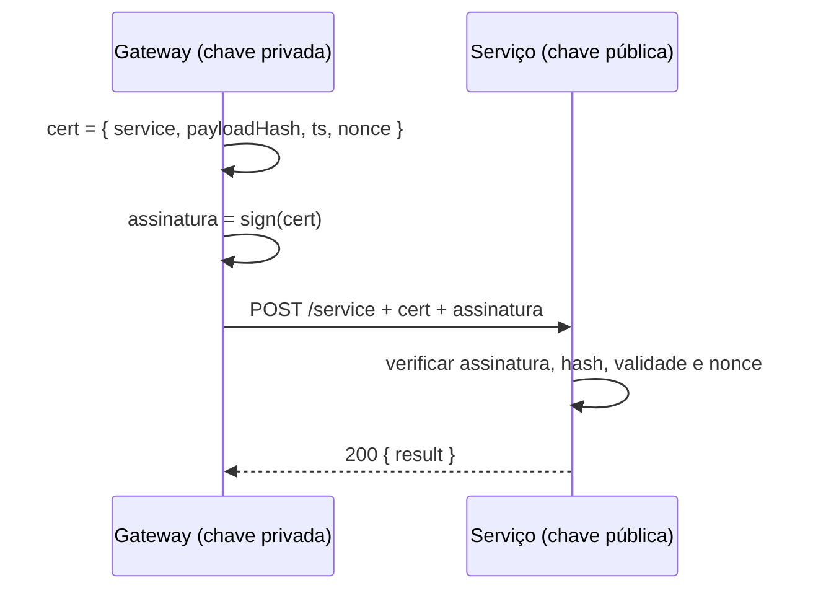

# Modelo de confiança

A plataforma prova uma chamada paga a um serviço com uma **assinatura assimétrica**:

- A plataforma guarda uma chave **privada** ed25519 que nunca revela.
- Cada serviço é configurado com a chave **pública** da plataforma (`platform.publicKey`, endereço Stellar `G…`, seguro de publicar).
- Em cada chamada, a plataforma cria um certificado curto `{ service, payloadHash, ts, nonce }` e o assina. O serviço verifica:
  - a assinatura;
  - se o hash corresponde ao corpo recebido;
  - se o certificado é recente (o relógio não pode desviar mais de ~2 minutos);
  - se o nonce não foi usado antes.

:::tip[Por que assimétrica]
Como o que um serviço guarda (uma chave pública) não serve para emitir chamadas, vazar a configuração de um serviço **nunca** permite se passar pela plataforma perante outros serviços.
:::

## Sem confiar em nenhuma plataforma

Quem chama sem confiar em nenhuma plataforma usa a rota de **escrow x402** (a padrão de `call()`): o serviço confere o escrow on-chain e o libera depois de atender. Mais lenta, mas sem parte de confiança. Veja [Pagamentos e liquidação](/conceptos/pagos-y-liquidacion#llamada-con-escrow-directo-sdk).

Se você opera seu próprio gateway, você mesmo assina os certificados: veja [Opere sua própria plataforma](/sdk/operar-tu-plataforma).
