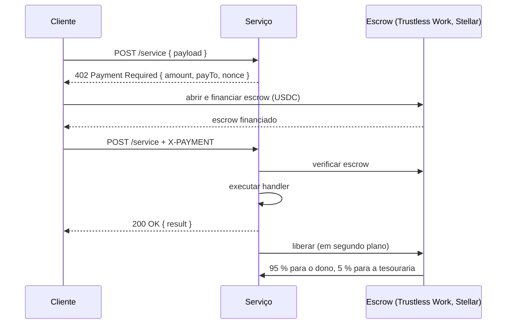

# Pagamentos e liquidação

A Kiba usa o padrão **x402**: uma requisição HTTP recebe `402 Payment Required` com uma cotação, quem chama paga e tenta de novo com prova de pagamento. A divisão escala com o valor cotado, então o preço dinâmico funciona sem configuração extra.

## Duas rotas de pagamento

| Rota | Quem usa | Velocidade | Confiança |
|---|---|---|---|
| **Assinada pela plataforma** (via gateway) | Assistentes e usuários do dashboard que pagam com créditos | Centenas de ms (~170 ms medido na testnet) | O serviço verifica a assinatura da plataforma; os ganhos são liquidados em lote |
| **Escrow x402 direto** | Clientes do SDK que pagam com a própria wallet | 15 a 150 s | Totalmente sem confiança, on-chain |

### Chamada assinada pela plataforma

1. O gateway debita os créditos do usuário.
2. Chama o serviço com um certificado curto assinado: nome do serviço, hash do payload, carimbo de tempo e nonce. O serviço verifica a assinatura com a chave **pública** da plataforma; nenhum segredo compartilhado trafega.
3. O serviço responde. O gateway registra o ganho no livro do publisher. Se o serviço falhar, o débito é reembolsado.
4. <TW /> O gateway financia o **escrow de liquidação** vigente do publisher na Trustless Work com o valor da chamada. A resposta inclui um link do explorador para essa transação.
5. Periodicamente o ciclo é **liquidado**. <TW /> O escrow é liberado e o saldo é transferido para a wallet do publisher; a Trustless Work aplica a comissão da plataforma ao liberar.

### Chamada com escrow direto (SDK) {/* #llamada-con-escrow-directo-sdk */}

O cliente abre e financia um escrow de liberação única que nomeia o serviço como recebedor, chama o serviço com o id do escrow no header `X-PAYMENT` e o serviço libera os fundos depois de atender. **Cada escrow é atendido uma única vez.**

<TW /> No diagrama, o escrow hoje é a Trustless Work.

## A divisão 95/5

`platformFee = 5` (equivale a 500 bps): em cada chamada, **95 % vão para o dono do serviço e 5 % para a tesouraria da Kiba**.

## Liquidação em lote (gateway) {/* #liquidación-por-lotes-gateway */}

- **Valor mínimo para liquidar:** 1 USDC por padrão (`SETTLEMENT_MIN_PAYOUT`, 10.000.000 unidades base), para evitar poeira.
- **Liquidação automática (cron):** só roda para serviços cujo dono ativou o opt-in; o resto é liquidado sob demanda com [`POST /v1/publisher/settle`](/api/endpoints#publisher).
- **Sem pagamentos duplicados:** o claim marca as linhas com um `settlement_id` antes de pagar on-chain. Chamadas concorrentes não são liquidadas duas vezes, e um pagamento que falha libera as linhas para nova tentativa.
- **Interruptor de emergência:** `SETTLE_SWEEP=0` volta para a liquidação clássica.

## O que o publisher vê

Ganhos e liquidações aparecem no [painel do dashboard](/publica-un-servicio/panel-de-publisher) e em `GET /v1/publisher/{overview,settlements,analytics}`, sempre **líquidos** de comissão. O pagamento chega à conta Stellar **dona do registro on-chain**.
