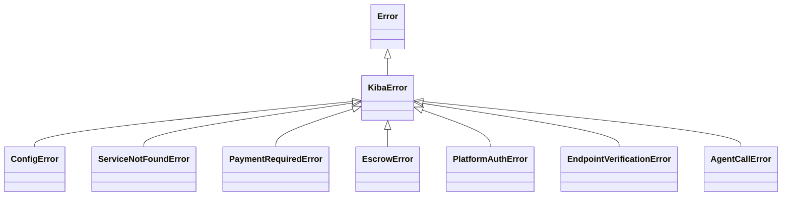

# Erros do SDK

Todo erro que o SDK lança de propósito é uma instância de **`KibaError`**, então você pode capturar o erro base e ramificar pela subclasse concreta. As mensagens estão em inglês e são estáveis para comparação.



## Catálogo

| Classe | Quando ocorre | Campos extras | O que fazer |
|---|---|---|---|
| `ConfigError` | Configuração inválida ou incompleta (falta `contractId`, endereço da plataforma vazio…) | — | Revise as opções e variáveis em [Configuração](/sdk/configuracion). |
| `ServiceNotFoundError` | O serviço não está no registro nem no backend de descoberta | `service` | Confira o nome e se o serviço está registrado. |
| `PaymentRequiredError` | O provider rejeitou a requisição porque o pagamento faltou ou foi insuficiente | — | Repita a chamada com `call()`, que resolve o handshake x402. |
| `EscrowError` | Uma operação de escrow falhou (abrir, financiar, liberar, reembolsar) ou o escrow não cumpre as regras de vinculação (recebedor errado, já consumido, fundos insuficientes) | `recoverable`, `service`, `escrowId`, `nonce` | Se `recoverable` for `true`, os fundos podem estar bloqueados e são recuperados pelo fluxo de disputa. <TW /> |
| `PlatformAuthError` | Não foi possível verificar uma chamada assinada pela plataforma | `reason` | Veja `reason` (tabela abaixo). |
| `EndpointVerificationError` | O `/manifest` do endpoint informa outro serviço ou outro dono que não o do registro on-chain | `service` | Não chame esse endpoint. Veja [Nomes e confiança](/publica-un-servicio/nombres-y-confianza#verificación-de-endpoint). |
| `AgentCallError` | A chamada ao serviço remoto falhou (erro de transporte, resposta não 2xx, timeout) | `service`, `status` | Confira o payload com a descrição do serviço e tente de novo se for transitório. |

## Motivos de `PlatformAuthError`

| `reason` | Significado |
|---|---|
| `missing` | A requisição não traz os headers de assinatura da plataforma |
| `malformed` | Os headers não têm o formato esperado |
| `bad-signature` | A assinatura não corresponde à chave pública configurada |
| `wrong-service` | O certificado é de outro serviço |
| `payload-mismatch` | O hash do certificado não coincide com o corpo recebido |
| `expired` | O certificado venceu; confira se o relógio do host está a ~2 minutos da hora real |
| `replayed` | O nonce já foi usado |
| `not-configured` | O provider não tem `platform.publicKey` configurada |

## Exemplo

```ts
import {
  KibaError,
  ServiceNotFoundError,
  EscrowError,
  AgentCallError,
} from 'kiba-sdk';

try {
  await client.call('translator-pro', { text: 'hello' });
} catch (err) {
  if (err instanceof ServiceNotFoundError) {
    console.error(`O serviço ${err.service} não existe`);
  } else if (err instanceof EscrowError && err.recoverable) {
    console.error(`Fundos bloqueados no escrow ${err.escrowId}`);
  } else if (err instanceof AgentCallError) {
    console.error(`O serviço respondeu ${err.status}`);
  } else if (err instanceof KibaError) {
    console.error(err.name, err.message);
  } else {
    throw err;
  }
}
```

Os erros da API REST do gateway são diferentes: veja [Erros da API](/api/errores).
